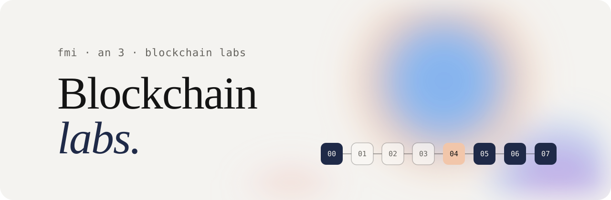
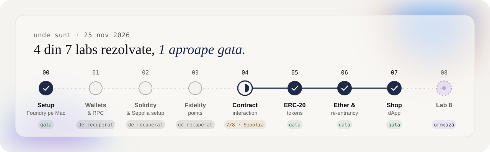
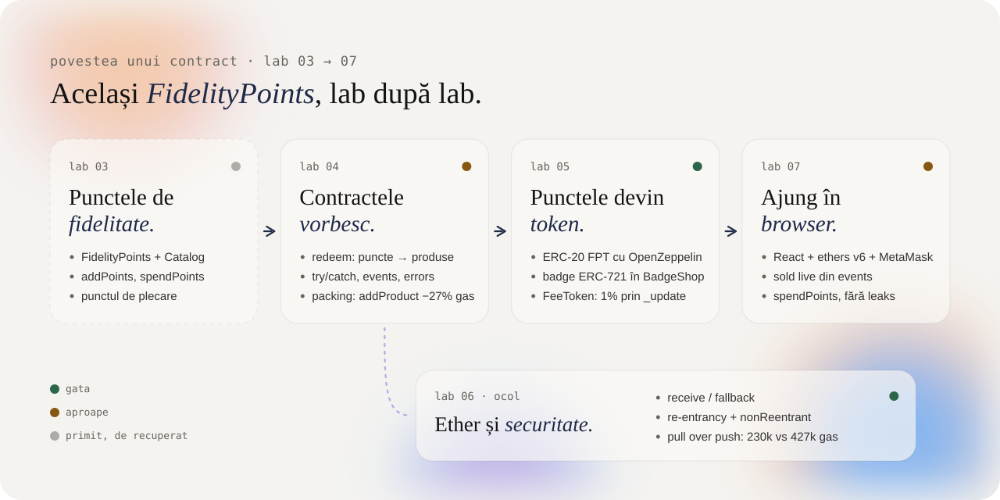

<p align="center">
  <picture>
    <source media="(prefers-color-scheme: dark)" srcset="assets/banner-dark.svg">
    
  </picture>
</p>

<p align="center">
  <a href="https://github.com/erikaplesca/blockchain-labs/actions/workflows/tests.yml"></a>
  
  
  
  
  
</p>

# Blockchain labs.

`fmi · an 3 · blockchain`

aici țin laboratoarele de Blockchain, *rezolvate pas cu pas, cu câte un raport pentru fiecare.*

Am vrut ca fiecare să rămână curat: enunțul, codul primit, soluția mea, testele care o dovedesc și un `RAPORT.md` cu răspunsurile la toate întrebările. Dacă ești coleg și vrei să vezi cum am rezolvat ceva, ești în locul potrivit.

## Unde sunt

<picture>
  <source media="(prefers-color-scheme: dark)" srcset="assets/progress-dark.svg">
  
</picture>

`acum · între lab 07 și lab 08`

Labs 5 și 6 sunt complete. La Lab 4 mai am Ex 8 (deploy pe Sepolia), pentru care îmi trebuie setup-ul din Lab 2: MetaMask, Infura și ether de test. La Lab 7 codul e gata, mai pun cele 8 screenshots în raport. Labs 1–3 le recuperez. Lab 1 e un exercițiu de echipă, iar conceptele din Lab 3 le-am folosit deja în Lab 4.

## Laboratoarele

| | tema | stare | raport | teste |
|:--:|---|:--:|:--:|:--:|
| `00` | [**Setup**](labs/00-setup/): Foundry pe Mac | 🟢 gata | – | – |
| `01` | [**Wallets & RPC**](labs/lab01-wallets-rpc/): adrese, chain ID, nonce | ⚪ de recuperat | – | – |
| `02` | [**Solidity & Sepolia**](labs/lab02-solidity-setup/): MetaMask, Infura, faucet | ⚪ de recuperat | – | – |
| `03` | [**Fidelity points**](labs/lab03-fidelity-points/): bazele Solidity, primul proiect Foundry | ⚪ de recuperat | – | – |
| `04` | [**Contract interaction**](labs/lab04-contract-interaction/): redeem, events, errors, gas | 🟡 7 / 8 | [raport](labs/lab04-contract-interaction/RAPORT.md) | 41 |
| `05` | [**ERC-20 tokens**](labs/lab05-erc20-tokens/): OpenZeppelin, FPT, taxă pe transfer | 🟢 2 / 2 | [raport](labs/lab05-erc20-tokens/RAPORT.md) | 58 |
| `06` | [**Ether & re-entrancy**](labs/lab06-ether-reentrancy/): receive, fallback, pull over push | 🟢 4 / 4 | [raport](labs/lab06-ether-reentrancy/RAPORT.md) | 38 |
| `07` | [**Shop dApp**](labs/lab07-shop-dapp/): React + ethers v6 + MetaMask | 🟡 4 / 4, fără screenshots | [raport](labs/lab07-shop-dapp/RAPORT.md) | 4 |

## Povestea contractului

<picture>
  <source media="(prefers-color-scheme: dark)" srcset="assets/story-dark.svg">
  
</picture>

Majoritatea laboratoarelor construiesc pe același contract, `FidelityPoints`. În Lab 3 e un simplu registru de puncte. În Lab 4 vorbește cu `Catalog`, ca punctele să se poată schimba pe produse. În Lab 5 punctele devin un token ERC-20, iar în Lab 7 ajung într-o pagină web. Lab 6 e un ocol prin *design patterns*: cum circulă ether-ul și cum te aperi de re-entrancy.

## Cum e organizat

Fiecare lab are folderul lui în [`labs/`](labs/), cu aceeași structură:

```
labs/lab0N-<tema>/
├── README.md       pe scurt: ce am făcut, ce am măsurat, cum rulezi
├── RAPORT.md       raportul meu: comenzi, output-uri, răspunsuri, „întrebări pe care mi le-ar putea pune”
├── enunt.md        enunțul laboratorului
├── starter/        codul primit, punctul de plecare
├── screenshots/    capturile din raport
├── src/  test/     soluția (proiect Foundry, se rulează direct din folder)
└── lib/            forge-std / OpenZeppelin, ca git submodules
```

## Cum rulezi la tine

```bash
git clone --recursive https://github.com/erikaplesca/blockchain-labs.git
cd blockchain-labs/labs/lab06-ether-reentrancy
forge test
```

Dacă ai clonat fără `--recursive`, rulează `git submodule update --init --recursive`.

**Setup pe Mac, pas cu pas:** fiecare lab are în README-ul lui o secțiune *Setup pe Mac*, cu ce instalezi, cum creezi proiectul din `starter/` și cum pornești `anvil`. Ordinea bună: [00-setup](labs/00-setup/#setup-pe-mac) (Foundry și diferențele față de Linux), apoi [Lab 02](labs/lab02-solidity-setup/#setup-pe-mac) (MetaMask, Infura, keystore-ul `sepolia-dev`, `.env`). Lab 7 are nevoie și de Node.js și de MetaMask pe rețeaua anvil: [pașii lui](labs/lab07-shop-dapp/#setup-pe-mac).

La fiecare push, GitHub Actions rulează `forge test` pentru labs 4–7. Badge-ul verde de sus înseamnă că toate cele 141 de teste trec.

## Pentru colegi

- **Începe cu `RAPORT.md`** din labul care te interesează. Are răspunsurile la întrebările din enunț și, la final, întrebările pe care le-ar putea pune profesorul.
- **Testele au numele exercițiului**, de exemplu `test_3_1_...` în Lab 6, deci găsești repede codul pentru un punct anume.
- **Eu lucrez pe macOS.** Unde enunțul e pentru Linux, diferențele sunt notate în rapoarte.
- Enunțurile și codul din `starter/` sunt materialele cursului. Soluțiile și rapoartele sunt ale mele: uită-te, înțelege, dar scrie-ți propriul cod.

<br>

<sub>macOS · Foundry 1.9.0 · solc 0.8.38 · OpenZeppelin 5.7.0 · React 19 + Vite 7 · ethers.js v6 · anvil (chain ID 31337)</sub><br>
<sub>vizualurile se regenerează cu <code>python3 assets/make_assets.py</code> · made by <a href="https://github.com/erikaplesca">@erikaplesca</a></sub>
