# Laborator 4: interacțiunea dintre contracte, erori, events și gas

**Erika Plesca**, FMI, anul 3, Blockchain
Mediu: macOS, Foundry 1.9.0, solc 0.8.38, anvil (chain ID 31337), optimizer oprit (implicit)

```
lab04-contract-interaction/   (proiectul Foundry)
├── RAPORT.md
├── enunt.md
├── starter/   contractele primite (soluțiile Lab 3)
├── screenshots/
├── src/   Catalog.sol, FidelityPoints.sol, FidelityPointsRequire.sol (7.4)
└── test/  Redeem.t.sol (Ex 4), RedemptionHistory.t.sol (2.4), Truncation.t.sol (5.4),
           CatalogGas.t.sol (5.6), ManyProducts.t.sol (6.1-6.2), RemoveProduct.t.sol (6.3),
           GetProducts.t.sol (6.4), FidelityGas.t.sol, BatchGas.t.sol, RequireVsError.t.sol (Ex 7)
```

Pe Mac am schimbat câteva lucruri față de ghid:

- `sed -i ''` în loc de `sed -i`;
- `date -r` în loc de `date -d`;
- `setopt interactivecomments` în `~/.zshrc`, ca să meargă comentariile `#` în terminal;
- adresele de deploy le iau automat cu `awk '/Deployed to/{print $3}'`.

---

## Exercițiul 1: Redeem

### 1.1–1.2 `ICatalog` și `redeem`

```solidity
interface ICatalog {
    function getPrice(bytes32 code) external view returns (uint);
    function decreaseStock(bytes32 code, uint amount) external;
}

function redeem(bytes32 code, uint quantity) external returns (bool) {
    if (address(catalog) == address(0)) revert CatalogNotSet();             // checks
    uint cost = catalog.getPrice(code) * quantity;
    uint required = (cost + pointValue - 1) / pointValue;                    // rotunjire în sus
    uint available = points[msg.sender];
    if (available < required) revert InsufficientPoints(required, available);
    points[msg.sender] = available - required;                               // effects
    updateTotalPoints(required, false);
    ...catalog.decreaseStock(code, quantity);                                // interactions
}
```

- **Interfața** conține doar cele 2 funcții de care am nevoie. `catalog` e un simplu `address` în slotul 4, declarat după variabilele vechi, ca să nu le mute.
- **Rotunjirea în sus:** 55 / 10 ar da 5 puncte, iar magazinul ar pierde 5. Cu `(55 + 9) / 10` ies **6** puncte.
- **Checks–effects–interactions:** scad punctele **înainte** de apelul extern care modifică starea, ca un contract apelat să nu poată reintra în `redeem` cât timp clientul încă are punctele vechi. `getPrice` e `view` (`STATICCALL`), deci nu poate modifica nimic.

### 1.3 `decreaseStock` doar pentru admin sau pentru programul de fidelitate

```solidity
modifier onlyAdminOrFidelityProgram() {
    if (msg.sender != admin) {
        require(fidelityProgram != address(0), "Fidelity program not set");   // Error(string)
        if (msg.sender != fidelityProgram) revert NotAuthorized(msg.sender);  // custom error
    }
    _;
}
```

**Ce `msg.sender` vede `Catalog` la `redeem`?**
Adresa contractului **`FidelityPoints`**, nu a clientului. `msg.sender` e mereu apelantul **imediat**, de asta merge verificarea `msg.sender == fidelityProgram`.

**De ce nu `tx.origin`?**
`tx.origin` e mereu cel care a semnat tranzacția. Dacă admin-ul e păcălit să cheme un contract malițios, acel contract ar trece de `tx.origin == admin`. Autorizarea se face pe `msg.sender`.

### 1.4 Pe anvil

Am făcut deploy, am legat contractele în ambele sensuri (`setCatalog`, `setFidelityProgram`), am adăugat P001 (preț 50, stoc 10) și i-am dat clientului 100 de puncte. Apoi clientul a făcut 2 × `redeem` de câte 2 bucăți:

| | preț | puncte necesare | puncte client | stoc |
|---|---|---|---|---|
| inițial | 50 | – | 100 | 10 |
| primul `redeem` | 50 | 10 | **90** | **8** |
| cu promoție de 20% | 40 | 8 | **82** | 6 |

O singură tranzacție a modificat storage-ul ambelor contracte. Legătura dintre ele e doar câte o adresă: `cast storage $FP 4` dă adresa `Catalog`, iar `cast storage $CAT 7` dă adresa `FidelityPoints`.

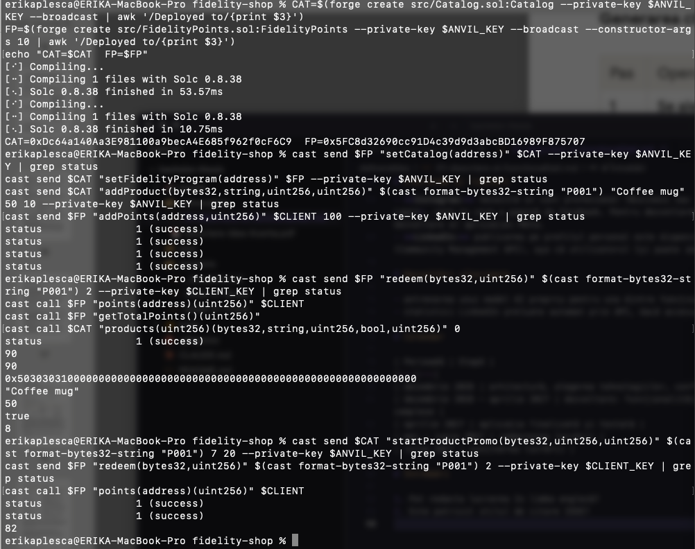

### 1.5 Produs inexistent

Clientul primește chiar **`ProductNotFound("P999")`**, eroarea din `Catalog`. Ea face *bubble up*: `getPrice` dă revert, apelul nu e în `try`, deci `redeem` dă revert cu aceleași error data.

Error data e `0xb9780c7f` (selectorul, confirmat cu `cast sig "ProductNotFound(bytes32)"`), urmat de `"P999"`. Tranzacția nici n-a fost trimisă: a picat deja la estimarea gas-ului.

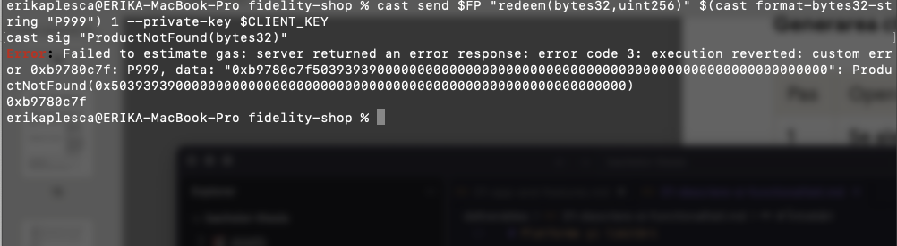

### 1.6 `try` / `catch`

```solidity
try catalog.decreaseStock(code, quantity) { return true; }
catch Error(string memory) { nbFailedError += 1; }
catch Panic(uint)          { nbFailedPanic += 1; }
catch (bytes memory)       { nbFailedRevert += 1; }
points[msg.sender] += required;      // restitui punctele
updateTotalPoints(required, true);
return false;
```

Am provocat câte un eșec de fiecare tip:

| Eșec | Cauza | Clauza | Rezultat |
|---|---|---|---|
| 1 | `fidelityProgram` nesetat, deci `require` | `catch Error` | `nbFailedError = 1`, punctele rămân 100 |
| 2 | 11 bucăți cu stoc 10, deci underflow | `catch Panic` (0x11) | `nbFailedPanic = 1` |
| 3 | FP nu mai e autorizat, deci `NotAuthorized` | `catch (bytes)` | `nbFailedRevert = 1` |

Toate tranzacțiile au `status 1`: eroarea e prinsă, iar clientul își primește punctele înapoi. Erorile custom ajung în `catch (bytes)`, pentru că nu au o clauză proprie.

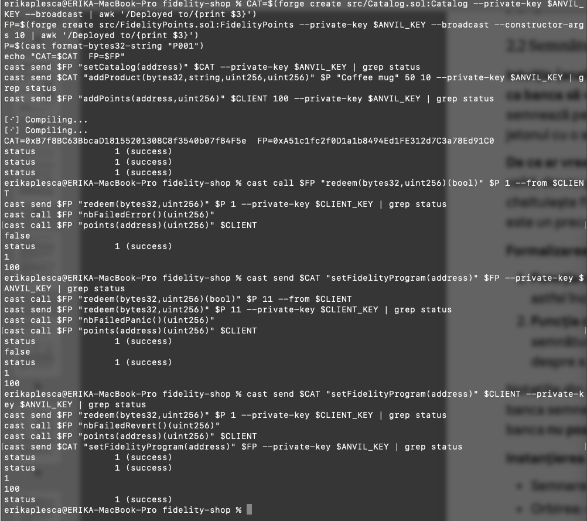

**De ce ar rămâne contoarele la 0 dacă `redeem` ar face revert după `catch`?**
Revert-ul anulează **toate** modificările de stare din tranzacție, inclusiv `nbFailedError += 1`. Gas-ul consumat se plătește totuși.

---

## Exercițiul 2: Events

### 2.1–2.2

| Contract | Event | Unde |
|---|---|---|
| FidelityPoints | `PointsAdded(client indexed, amount)` | `addPoints` |
| | `PointsSpent(client indexed, amount)` | `spendPoints` |
| | `PointValueChanged(old, new)` | `setPointValue`, emis **înainte** de atribuire, ca să am valoarea veche |
| | `PointsRedeemed(client indexed, code indexed, quantity, pointsSpent)` | `redeem`, în `try` |
| | `RedemptionFailed(client indexed, code indexed, bytes reason)` | `redeem`, după `catch` |
| Catalog | `ProductAdded`, `StockChanged`, `PromoStarted` | `addProduct`, `increaseStock`/`decreaseStock`, promoțiile |

`client` și `code` sunt `indexed`, adică devin **topics**, ca să pot filtra după ele: „toate cumpărăturile clientului X”. Valorile care nu sunt folosite la căutare stau în `data`, care e mai ieftin.

La `RedemptionFailed`, `reason` e error data completă. Pentru `Error` și `Panic` o reconstruiesc cu `abi.encodeWithSignature`, ca toate cele 3 cazuri să aibă aceeași formă.

### 2.3 `cast logs`

```bash
cast logs --from-block 0 --address $FP "PointsRedeemed(address indexed, bytes32 indexed, uint256, uint256)" $CLIENT
cast sig-event "PointsRedeemed(address,bytes32,uint256,uint256)"     # 0x2bb3dc98...41f8
```

- `topics[0]` = hash-ul semnăturii, identic cu `cast sig-event`;
- `topics[1]` = clientul;
- `topics[2]` = `"P001"`;
- `data` = `2, 10` (primul `redeem`), respectiv `2, 8` (cu promoție).

Filtrul `$CLIENT` se aplică pe `topics[1]`, iar filtrarea o face nodul.

În receipt-ul unui `redeem` sunt **2 logs de la contracte diferite**: întâi `StockChanged` de la `Catalog`, apoi `PointsRedeemed` de la `FidelityPoints`. `address` din log e contractul care a dat `emit`, nu cel căruia i s-a trimis tranzacția.

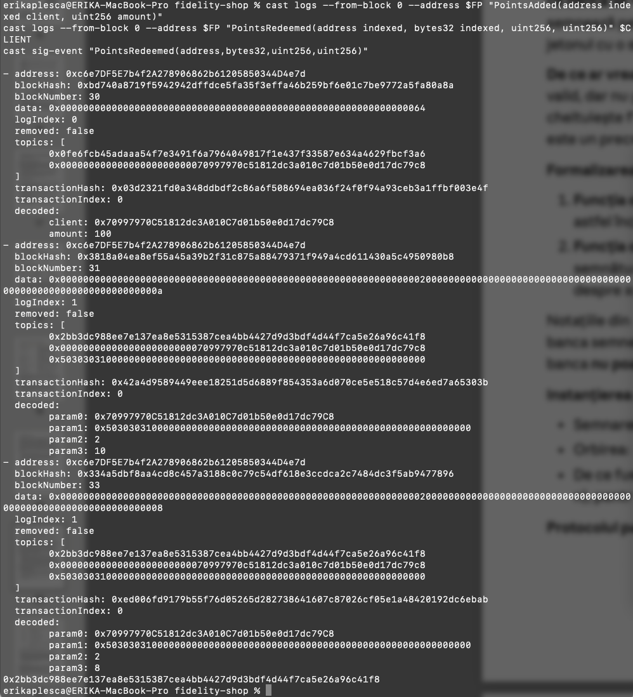
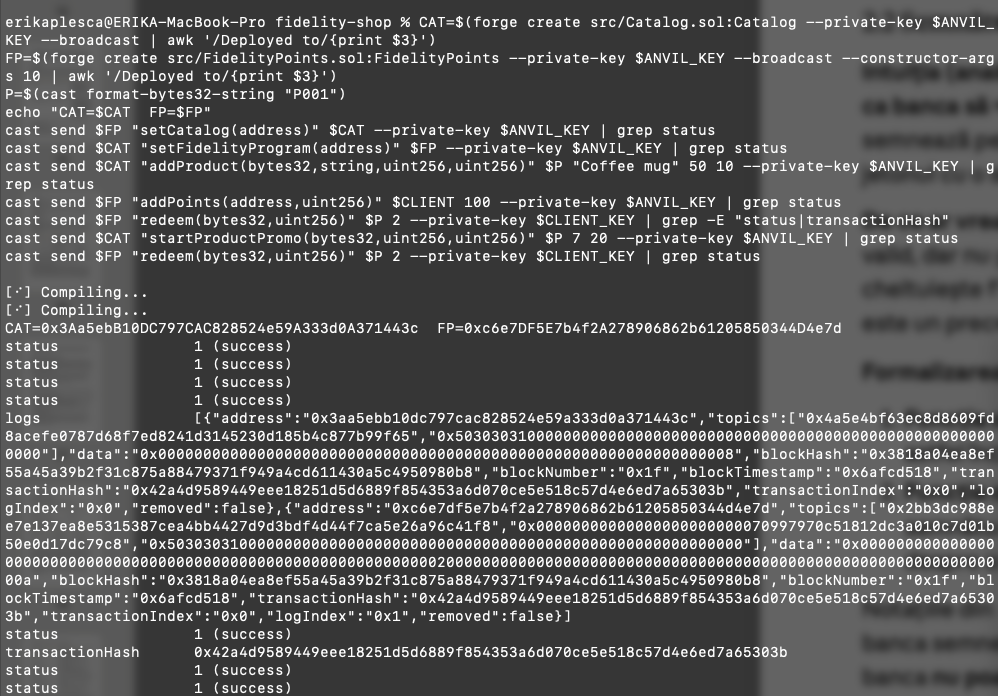

### 2.4 Istoric în storage vs events

**Estimarea:**

- un `Redemption` în storage ocupă 4 sloturi noi: 4 × 22.100 + 5.000 pentru `length` ≈ **93.400**;
- un event `LOG3` cu 64 de bytes de data: 375 + 3 × 375 + 8 × 64 ≈ **2.012**.

**Măsurat** (`forge test --match-contract RedemptionHistoryTest --gas-report --isolate`): event **24.905** vs storage **116.371** (al doilea element) / **133.471** (primul element). Diferența de 17.100 dintre ele vine din `length` 0 → 1, care e mai scump decât 1 → 2.

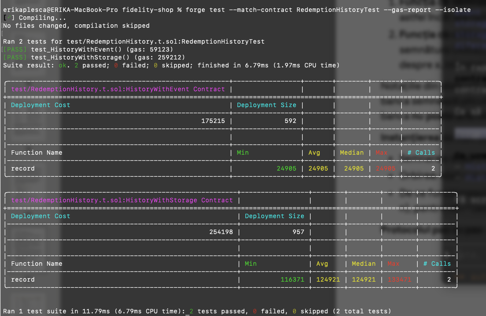

**Când e nevoie de storage?**
Când **un contract** trebuie să citească istoricul (de exemplu un retur, sau o limită de cumpărături pe client), pentru că contractele nu pot citi logs. Pentru afișare în site, events ajung.

---

## Exercițiul 3: Modifiers și erori

### 3.1–3.2

- **Pauza:** `whenNotPaused` pe `addPoints`, `spendPoints`, `redeem`. `whenPaused` pe `setPointValue`, ca valoarea punctului să nu se schimbe în timp ce clienții cumpără. `pause` și `unpause` sunt `onlyAdmin`.
- **`paused`** (1 byte) încape în slotul 0, lângă `admin` (offset 20), deci **celelalte variabile nu se mută**. Ghidul zice că s-ar muta cu unu, dar `forge inspect` arată că nu.
- **`validAmount(uint amount)`:** modifier cu argument, care dă `ZeroAmount()` pentru 0. Înlocuiește verificarea `ZeroQuantity` din `redeem`.

### 3.3 Ordinea modifiers

`addPoints` are `onlyAdmin whenNotPaused validAmount(_points)`. Pe anvil, cu programul pe pauză:

| Apel | Rezultat |
|---|---|
| client → `addPoints` | `NotAdmin(client)` |
| admin → `addPoints` | `ProgramPaused` |
| client → `spendPoints` | `ProgramPaused` |
| admin → `setPointValue(20)` | succes |
| fără pauză: `setPointValue(30)` | `ProgramNotPaused` |
| `addPoints(…, 0)` | `ZeroAmount` |

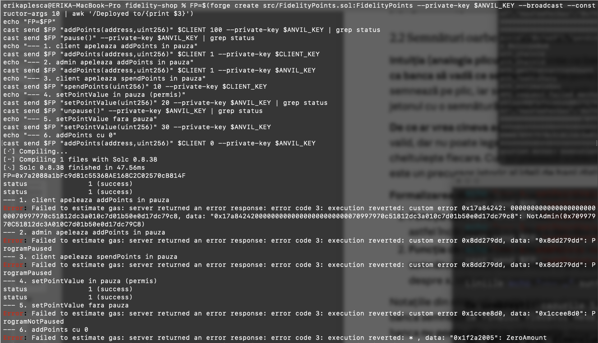

Modifiers se evaluează **de la stânga la dreapta**, iar primul care pică dă eroarea. Cu ordinea inversată (`whenNotPaused onlyAdmin`), clientul primește `ProgramPaused`:

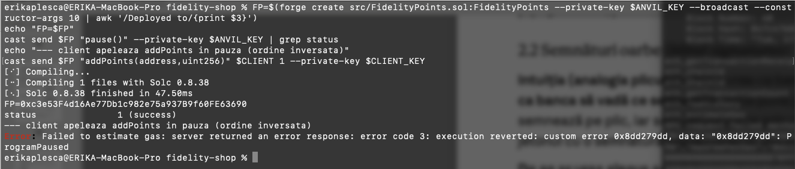

**Ce ordine e mai bună?** `onlyAdmin` primul:

- clientul primește motivul real (`NotAdmin`), nu `ProgramPaused`, care l-ar face să creadă că după `unpause` ar merge;
- cine n-are acces nu află detalii despre starea contractului.

### 3.4 `assert`

`assert(totalPoints >= points[msg.sender])` în `spendPoints` și `redeem`.

- **`require`/`revert`** sunt pentru erori „normale”, pe care le poate provoca utilizatorul (puncte insuficiente).
- **`assert`** e pentru un **invariant**, care nu poate fi încălcat decât dacă am un bug.

Un `assert` eșuat dă `Panic(0x01)`: `0x4e487b71` + `…01`.

### 3.5 Modifier → funcție internal

`onlyAdmin { _checkAdmin(); _; }`. Bytecode-ul a scăzut de la **6.255 B la 5.721 B (−534 B)**.

Modifier-ul e **copiat** în fiecare funcție care îl folosește, aici în 5 funcții. Acum verificarea și eroarea există o singură dată, iar în rest e doar un salt către funcție. Deploy-ul e mai ieftin, dar fiecare apel plătește câțiva gas în plus pentru salt.

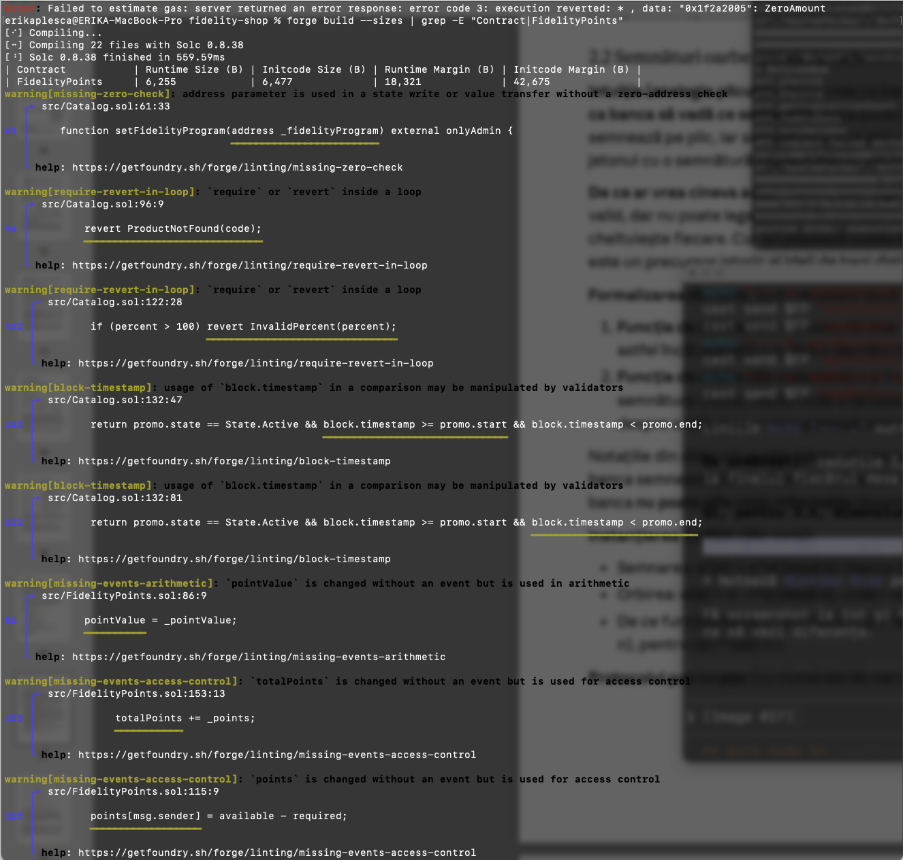
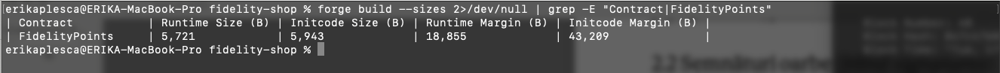

---

## Exercițiul 4: Teste

`test/Redeem.t.sol` are `setUp`-ul din ghid: P001 cu preț 55 și stoc 3, plus 100 de puncte pentru client.

| Test | Ce verifică |
|---|---|
| `test_RedeemUpdatesStateAndEmitsEvent` | 100 → 94 puncte, stoc 3 → 2, `PointsRedeemed(client, "P001", 1, 6)` (cu `vm.expectEmit`) |
| `test_PointsRoundedUpAndPromoReducesThem` | 55 → 6 puncte; cu 20% promoție, 44 → 5 puncte |
| `test_RevertWhen_InsufficientPoints` | `InsufficientPoints(110, 100)`, cu argumente (`abi.encodeWithSelector`) |
| `test_RevertWhen_ClientCallsDecreaseStock` | `NotAuthorized(client)` (cu `vm.prank`) |
| `test_RedeemMoreThanStockReturnsFalse` | `false`, punctele rămân 100, `nbFailedPanic = 1` |
| `test_RevertWhen_Paused` | `ProgramPaused` pentru `addPoints`, `spendPoints`, `redeem` |

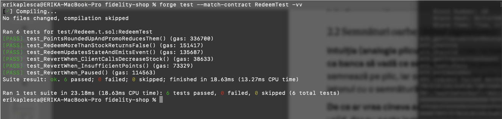

**Gas `redeem`** (`--gas-report --isolate`): median **87.983**. Din trace (`-vvvv`):

- `getPrice` = 25.924;
- `decreaseStock` = 15.129;
- apelurile în sine ≈ 3.000.

Deci **≈ 44.000, adică aproape jumătate**, vine din apelurile către catalog. Cel mai scump e `getPrice`, deși e `view`: citește multe sloturi **cold** (câte 2.100). `decreaseStock` găsește apoi sloturile deja warm.

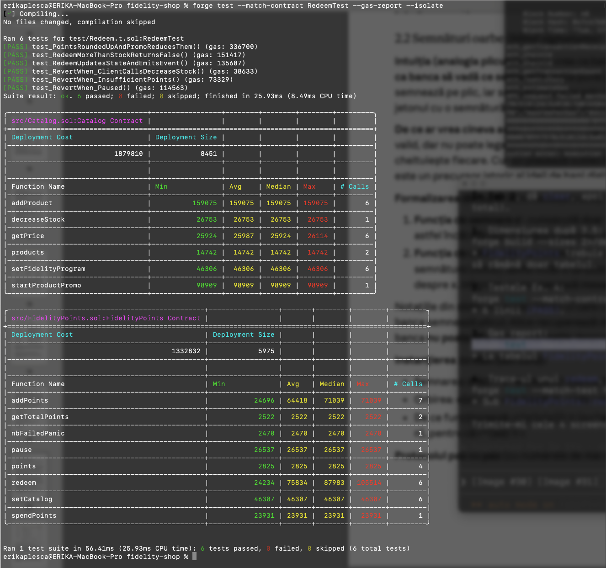
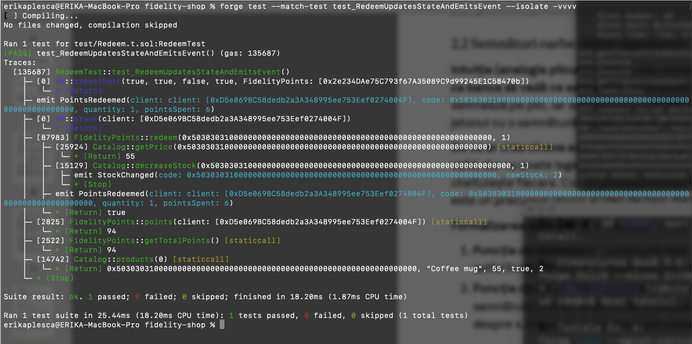

---

## Exercițiul 5: Storage layout și packing

### 5.1 Citire directă din storage

Înainte de packing, un `Product` avea 5 sloturi, deci `products[1].stock` e la `keccak256(0) + 5·1 + 4`. `generalPromo.end` e în slotul 3.

- **Stocul lui P002:** **5**.
- **Sfârșitul promoției:** **1795560123**, adică `Wed Nov 25 00:42:03 EET 2026` (cu `date -r`), fix 7 zile după start.

Getter-ul `generalPromo()` confirmă aceleași valori.

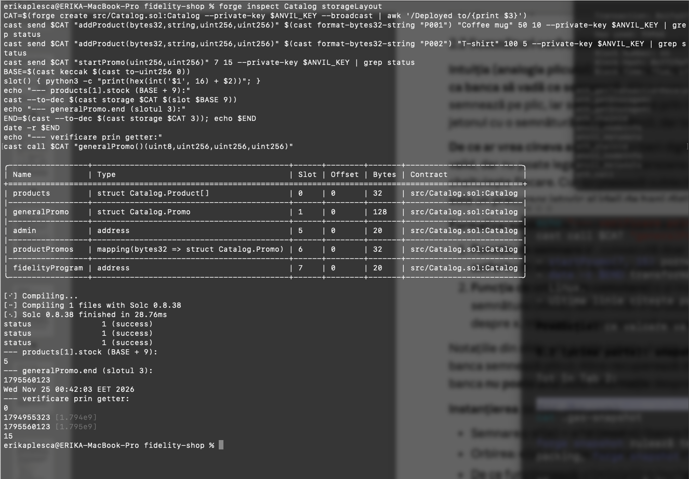

### 5.2 Packing

```solidity
struct Promo   { State state; uint40 start; uint40 end; uint8 percent; }          // 4 sloturi → 1
struct Product { bytes32 code; string description; uint128 price; uint64 stock; bool inStock; } // 5 → 3
```

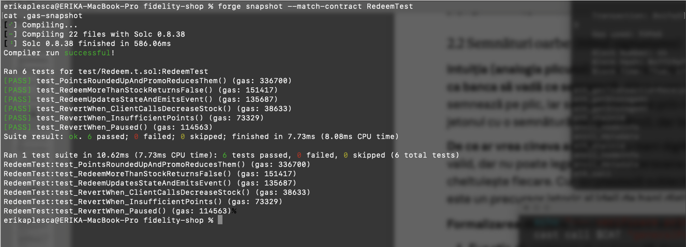
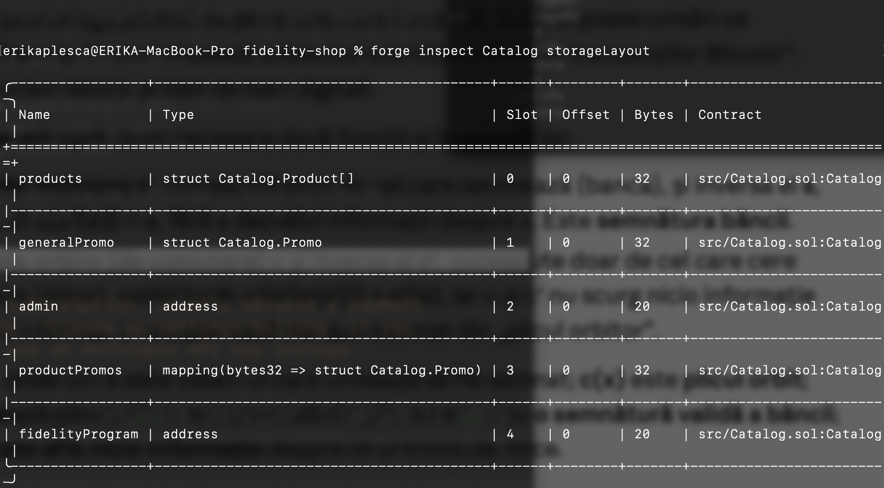

- **`Promo`:** 1 + 5 + 5 + 1 = 12 B, deci **1 slot**.
- **`Product`:** `code` 1 slot, `description` 1 slot, iar price + stock + inStock (25 B) încă **1 slot**. Total 3.
- **Ce s-a mutat:** `admin` (5 → **2**), `productPromos` (6 → **3**) și `fidelityProgram` (7 → **4**), pentru că sunt declarate după `generalPromo`, care s-a micșorat.

### 5.3 Efectul asupra gas-ului

`forge snapshot --diff`: **−132.666 (−15,6%)**.

| Funcție | Înainte | După |
|---|---|---|
| `addProduct` | 159.075 | 115.509 (2 sloturi noi mai puțin × 22.100) |
| `startProductPromo` | 98.909 | 53.692 (1 slot în loc de 4) |
| `getPrice` | 25.924 | 14.571 (`isActive` copia 4 sloturi pe promoție, acum 1) |
| `decreaseStock` (în `redeem`) | 15.129 | 11.787 |
| `redeem` | 87.983 | 73.288 |
| deploy `Catalog` | 1.879.810 | 2.244.995 (cod în plus pentru mascare) |

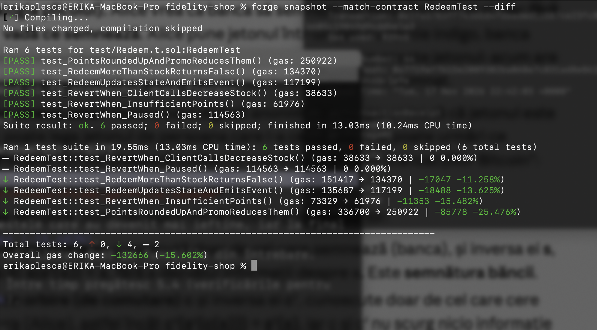
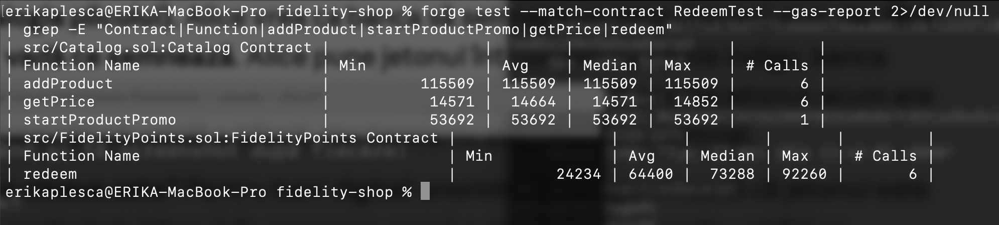

**De ce e `decreaseStock` mai ieftin, deși scrie aceleași 2 câmpuri?**

- `stock` și `inStock` sunt acum în **același slot**, deci se face un singur acces în loc de 2.
- În plus, slotul e deja **warm**: e același slot cu `price`, pe care `getPrice` l-a citit chiar înainte.

### 5.4 Trunchierea

`uint128(2**128 + 5)` dă **5**, fără eroare. Conversia păstrează doar biții de jos. Verificarea automată din 0.8 se face doar la `+ - *`, nu și la conversii. Cu o constantă, compilatorul refuză direct conversia (`Error 9640`).

Am adăugat `error ValueTooLarge(value, max)`, verificat în `addProduct` (`price`, `stock`) și în `increaseStock`, unde adunarea se face pe `uint` și abia apoi convertesc. Testele sunt în `test/Truncation.t.sol`, 5 teste.

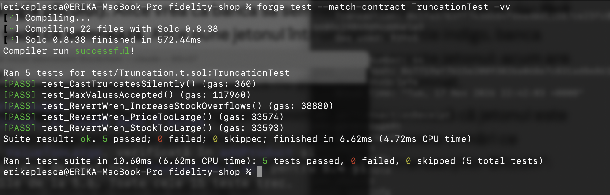

### 5.5 De ce ajunge `uint40` pentru un timestamp?

Timestamp-ul e în secunde: azi e ≈ 1,79 · 10⁹.

- `uint32` ajunge doar până în anul 2106.
- `uint40` = 2⁴⁰ s, adică ≈ **34.800 de ani**, și ocupă doar 5 bytes.

### 5.6 Fără `inStock`

`inStock` e mereu `stock > 0`, deci l-am scos. `Product` rămâne tot la 3 sloturi.

| | cu `inStock` | fără |
|---|---|---|
| `decreaseStock` | 41.779 | **41.253** |
| `getProducts(true, false)` | 28.178 | **27.525** |

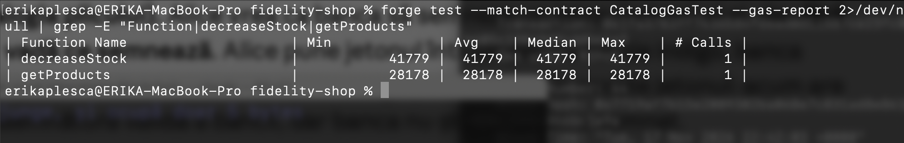
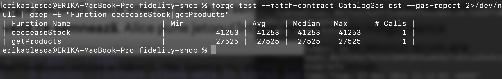

**Ce s-a schimbat:**

- **Funcții:** struct-ul, `addProduct`, `increaseStock`, `decreaseStock` și `matches`, care folosește acum `p.stock > 0`.
- **Teste:** tot ce destructurează `products(i)`, care întoarce acum 4 valori, nu 5: helper-ul `stockOf` și `test_MaxValuesAccepted`.

---

## Exercițiul 6: Arrays și mappings

### 6.1 100 de produse

`test/ManyProducts.t.sol`, rulat cu `--isolate`, ca fiecare apel să fie o tranzacție separată, cu sloturi cold:

| `decreaseStock` | gas |
|---|---|
| primul produs (P1) | 39.409 |
| ultimul produs (P100) | **284.854** |

Diferența e ≈ **2.479 pe produs**: `findProduct` parcurge array-ul de la început, iar fiecare iterație citește cold un `code` (2.100) plus `length`. Costul e O(n).

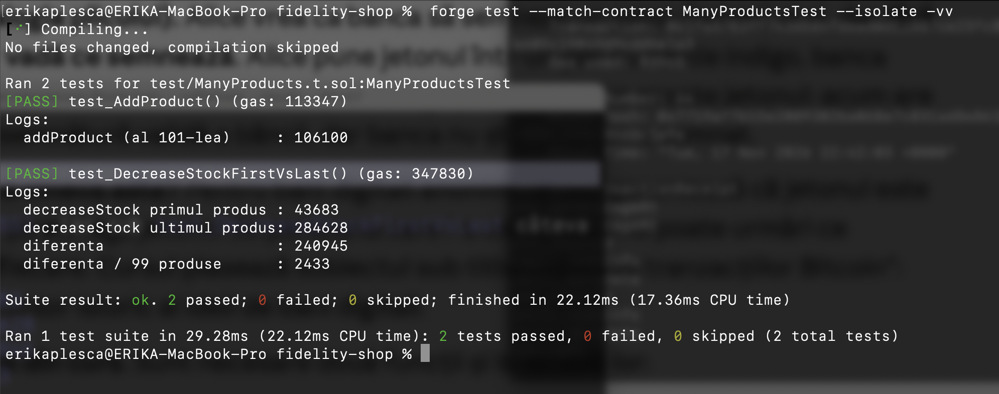

*Capcană:* în prima versiune a testului (cea din screenshot), prima măsurătoare ieșea cu ≈ 4.500 mai mare, din lucruri care nu țin de `decreaseStock`: citirea cold a variabilei `cat`, primul apel `vm.toString` și un cost fix pe care Foundry îl adaugă primei măsurători dintr-un test. Am rezolvat punând fiecare măsurătoare într-un test separat și calculând argumentele înainte de `startSnapshotGas`. Valorile corecte din tabel le-am măsurat așa, pe codul de dinainte de 6.2.

### 6.2 `productIndex` (poziție + 1)

```solidity
mapping(bytes32 => uint) productIndex;     // 0 = nu există
function findProduct(bytes32 code) internal view returns (uint) {
    uint index = productIndex[code];
    if (index == 0) revert ProductNotFound(code);
    return index - 1;
}
```

**De ce + 1?** Într-un mapping, orice cheie inexistentă dă 0. Fără +1, primul produs (poziția 0) n-ar putea fi deosebit de un cod care nu există.

`addProduct` dă `DuplicateProduct` dacă codul există deja.

| | buclă | mapping |
|---|---|---|
| `decreaseStock` P1 | 39.409 | 39.333 |
| `decreaseStock` P100 | 284.854 | **39.357** (O(1)) |
| `addProduct` | 101.698 | **124.093** (+22.395) |

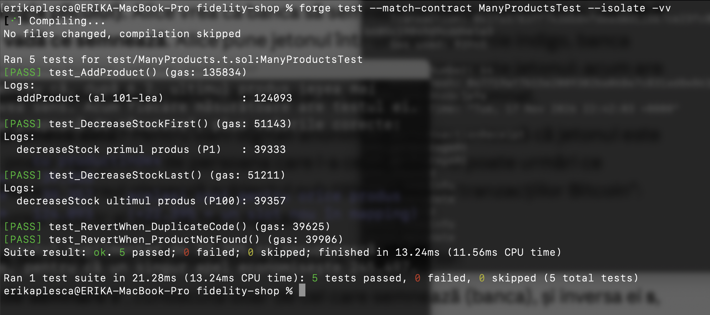

**Cât costă în plus `addProduct`?** +22.395: încă un slot nou în mapping (22.100). Se recuperează **din primul apel** pe ultimul produs, care economisește 245.497.

### 6.3 `removeProduct`: swap and pop

```solidity
function removeProduct(bytes32 code) external onlyAdmin {
    uint index = findProduct(code);
    uint lastIndex = products.length - 1;
    if (index != lastIndex) {
        products[index] = products[lastIndex];
        productIndex[products[index].code] = index + 1;
    }
    products.pop();
    delete productIndex[code];
    delete productPromos[code];
}
```

**De ce nu ajunge `delete products[i]`?** Doar pune câmpurile pe 0. Rămâne o gaură în array, iar `productIndex` arată încă spre ea, deci `getPrice` ar întoarce prețul 0, adică produsul ar deveni gratuit.

**Refund:** sloturile puse pe 0 dau înapoi 4.800 gas fiecare. Aici se golesc 4 sloturi, deci 19.200 în teorie, dar refund-ul e plafonat la **1/5 din gas** (EIP-3529):

| | gas | refund | final |
|---|---|---|---|
| `removeProduct(P1)`, cu swap | 74.314 | 14.862 (= 74.314 / 5) | 59.452 |
| `removeProduct(P100)`, doar pop | 54.650 | 10.930 | 43.720 |

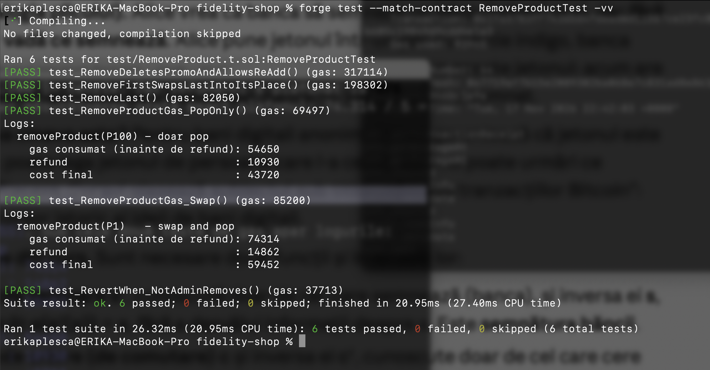

### 6.4 `getProducts` vs limita de 16.777.216

| produse | gas `getProducts(false, false)` |
|---|---|
| 100 | **1.003.460** (6% din limită) |
| 1.000 | 10.572.851 |
| 1.500 | 16.332.148 |
| 1.600 | 17.521.976, **peste limită** |

Limita se depășește pe la ≈ 1.540 de produse. Costul pe produs crește ușor, pentru că memoria se plătește **pătratic**.

**Dacă `redeem` ar apela `getProducts`:** fiecare `redeem` ar plăti ≈ 1M de gas. Peste ≈ 1.540 de produse, `redeem` nu s-ar mai putea executa deloc, adică un **DoS**. Atacul e posibil, pentru că `addProduct` n-are `onlyAdmin`: oricine poate umple catalogul.

**Paginare:** `getProducts(uint offset, uint limit)` costă **93.349** pentru o pagină de 10, la fel cu 100 sau 200 de produse.

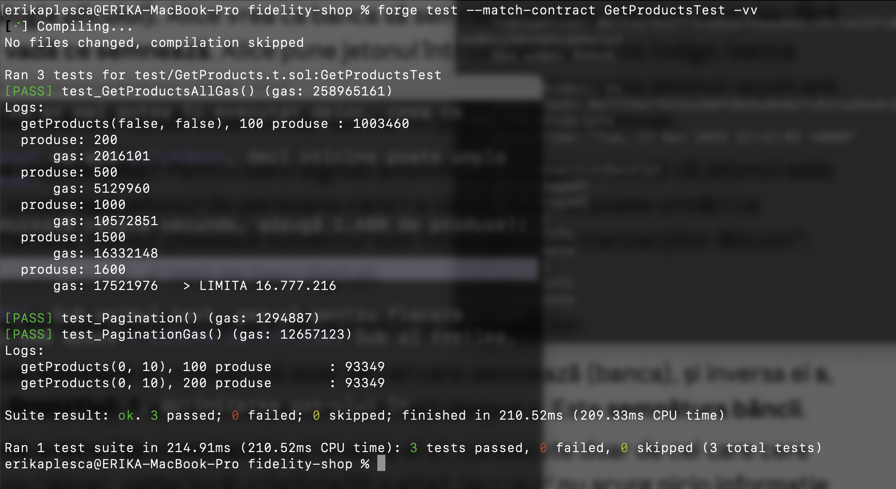

---

## Exercițiul 7: Optimizarea `FidelityPoints`

Am salvat baseline-ul cu `forge snapshot --match-contract FidelityGasTest --isolate` (copie în `.gas-snapshot-ex7-inainte`), apoi am aplicat modificările pe rând.

| Funcție | Înainte | După | Tehnică |
|---|---|---|---|
| `addPoints` | 44.540 | 44.355 | 7.1 `immutable admin` |
| revert `NotAdmin` | 35.964 | 33.830 | 7.1 `immutable admin` |
| `spendPoints` | 46.944 | 46.524 | 7.2 o citire + `unchecked` |
| `redeem` | 83.347 | 82.814 | 7.2 o citire + `unchecked` |
| revert puncte insuficiente | 37.228 | 37.349 | 7.2 eroare explicită în loc de `Panic` |
| puncte pentru 10 clienți | 552.700 (10 tx) | **299.728** (1 tx) | 7.3 batch, `calldata` |
| batch, `memory` în loc de `calldata` | 299.728 | 299.664 | 7.3 |
| bytecode | 7.695 B | 8.539 B | 7.4 `require` cu mesaj în loc de custom errors |
| deploy `FidelityPoints` | 1.734.363 | 1.027.646 / 1.296.718 | 7.5 optimizer, runs 1 / 1.000.000 |
| `redeem` | 72.018 | 67.795 / 67.096 | 7.5 optimizer, runs 1 / 1.000.000 |

Efectul total față de baseline (după toate modificările):

```bash
forge snapshot --match-contract FidelityGasTest --isolate --diff .gas-snapshot-ex7-inainte
```

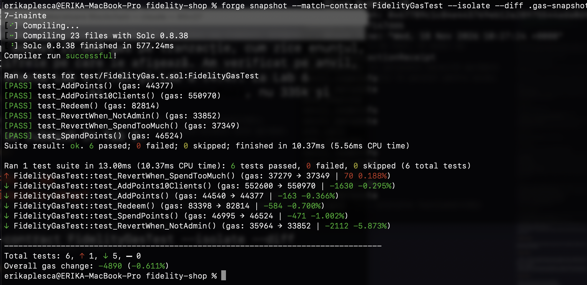

Total: **−4.890 gas**. `addPoints` apare aici cu 44.377, nu cu 44.355 ca după 7.1. Cele 22 de gas în plus vin din dispatcher: după 7.3 contractul are 2 funcții în plus, deci căutarea selectorului face un pas în plus.

### 7.1 `admin` `immutable`

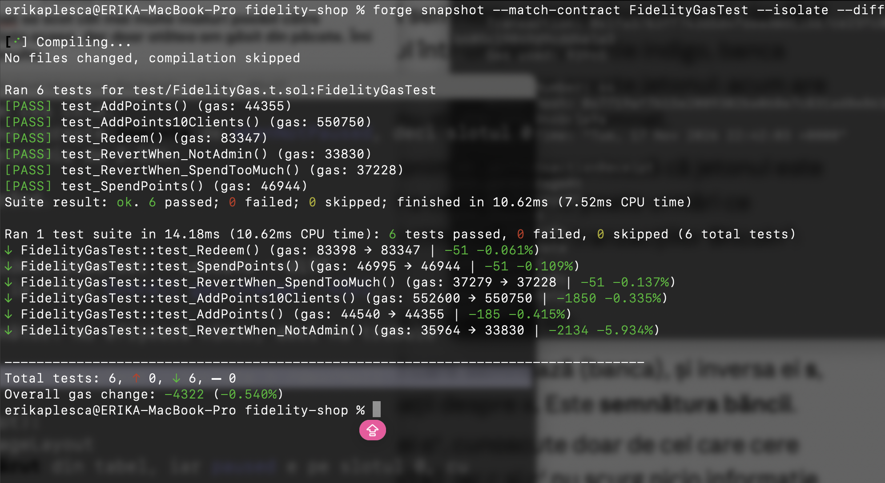
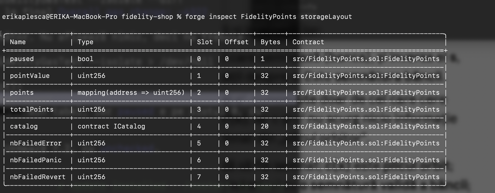

**De ce `addPoints` economisește doar 185, nu 2.100?** `paused` e în același slot cu `admin`. Înainte, slotul 0 era citit cold de `onlyAdmin` și apoi warm de `whenNotPaused`. Acum `admin` e în bytecode, dar `whenNotPaused` tot citește slotul 0 cold. Revert-ul `NotAdmin` economisește 2.134, pentru că se oprește înainte să citească slotul.

**Layout:** `admin` nu mai apare deloc, iar `paused` trece de la offset 20 la **offset 0**. Restul variabilelor rămân pe loc.

**De ce dau altceva comenzile `cast storage` din Lab 3?** `cast storage $FP 0` dădea adresa admin-ului. Acum dă `paused` (0 sau 1), pentru că `admin` nu mai e în storage: e scris direct în bytecode. Se citește cu `cast call $FP "admin()(address)"`.

### 7.2 O singură citire + `unchecked`

```solidity
uint available = points[msg.sender];
if (available < _points) revert InsufficientPoints(_points, available);
unchecked { remaining = available - _points; }
```

**De ce nu poate face overflow?** Linia de deasupra garantează deja că `available >= _points`. Verificarea compilatorului ar fi a doua oară aceeași.

**E sigur și pe `totalPoints`?** Da, din invariant: `totalPoints >= points[client] >= _points`. Riscul: dacă un bug viitor strică invariantul, scăderea trece prin zero și dă un număr uriaș, iar `assert` nu prinde asta.

Revert-ul cu puncte insuficiente costă cu 121 mai mult, pentru că `InsufficientPoints` are 2 argumente, iar `Panic` avea unul. În schimb, eroarea spune cât îi trebuie clientului și cât are.

### 7.3 `addPointsBatch`

`addPointsBatch(address[] calldata, uint[] calldata)` e `onlyAdmin`, iar `totalPoints` se scrie **o singură dată**, după buclă.

```bash
forge test --match-contract BatchGasTest --isolate -vv
```

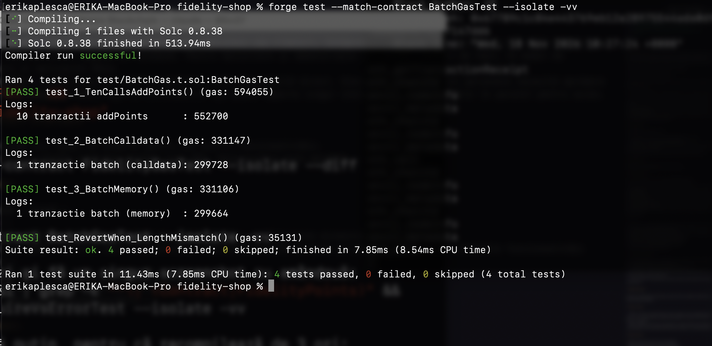

| 10 clienți | gas |
|---|---|
| 10 × `addPoints` (10 tranzacții) | 552.700 |
| `addPointsBatch`, `calldata` (1 tranzacție) | **299.728** (−46%) |
| `addPointsBatchMemory`, `memory` | 299.664 |

- **Cei 21.000 de bază:** enunțul zice să-i adun pentru fiecare tranzacție, dar **Foundry 1.9 îi include deja**. Am verificat pe un anvil separat: `addPoints` are `gasUsed = 53.560` în receipt, exact cât arată și testul. Deci n-am mai adunat nimic.
- **Ce se economisește:** 9 × 21.000 de bază, 9 scrieri pe `totalPoints` și 9 citiri cold ale slotului 0.
- **`memory` vs `calldata`:** la noi `memory` iese cu 64 gas mai ieftin, chiar și cu optimizer-ul pornit. Copierea a 2 array-uri mici de valori e ieftină, iar accesul în `calldata` are verificări de limite la fiecare citire. `calldata` câștigă când array-urile sunt mari sau sunt doar trimise mai departe.

### 7.4 `require` cu mesaj în loc de custom errors

Copia e în `src/FidelityPointsRequire.sol`, cu de exemplu `require(msg.sender == admin, "Not admin")`.

```bash
forge build --sizes 2>&1 | grep -E "Contract|FidelityPoints"
forge test --match-contract RequireVsErrorTest --isolate -vv
```

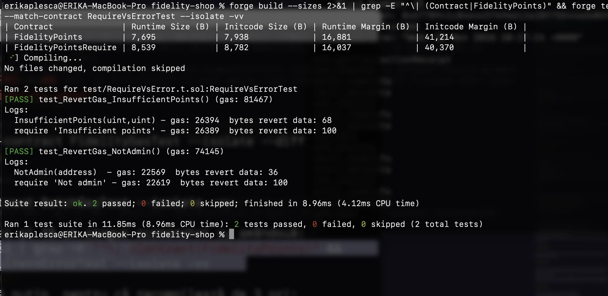

| | custom errors | `require` + mesaj |
|---|---|---|
| bytecode | **7.695 B** | 8.539 B (+844 B) |
| revert `addPoints` de la client | 22.569 | 22.619 |
| revert puncte insuficiente | 26.394 | 26.389 |
| bytes de revert data | 36 / 68 | 100 |

Custom errors câștigă la **mărimea bytecode-ului**, pentru că mesajele sunt stocate în cod. La un revert, gas-ul e aproape același. În plus, custom errors pot avea argumente (`InsufficientPoints(required, available)`).

### 7.5 Optimizer-ul

În `foundry.toml` am pus două profile, ca să nu stric măsurătorile de mai sus, făcute fără optimizer:

```toml
[profile.opt1]
optimizer = true
optimizer_runs = 1

[profile.opt1m]
optimizer = true
optimizer_runs = 1000000
```

```bash
for P in default opt1 opt1m; do echo "== $P"; FOUNDRY_PROFILE=$P forge test --match-contract FidelityGasTest --isolate --gas-report 2>/dev/null | grep -A20 "FidelityPoints.sol:FidelityPoints Contract" | grep -E "^\| +[0-9]|redeem "; done
```

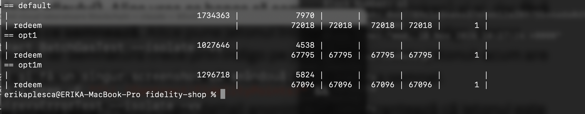

| | deploy | mărime | `redeem` |
|---|---|---|---|
| fără optimizer | 1.734.363 | 7.970 | 72.018 |
| `runs = 1` | **1.027.646** | 4.538 | 67.795 |
| `runs = 1.000.000` | 1.296.718 | 5.824 | **67.096** |

`optimizer_runs` înseamnă de câte ori presupune compilatorul că va fi apelat codul:

- **`runs = 1`:** optimizează pentru **deploy ieftin**, adică cod mic.
- **`runs = 1.000.000`:** optimizează pentru **apeluri ieftine**. Pune mai mult cod inline, deci bytecode-ul e mai mare, dar fiecare `redeem` e mai ieftin.

Pentru un contract apelat des, ca `FidelityPoints`, merită `runs` mare.

---

## Exercițiul 8: Deploy pe Sepolia

*De făcut.* Am nevoie de setup-ul din Lab 2:

- MetaMask cu un cont de test;
- endpoint Infura pentru Sepolia;
- ETH de test de la un faucet;
- keystore-ul `cast wallet import sepolia-dev --interactive`.

Plus un coleg care să facă `redeem` din contul lui.

---

## Întrebări pe care mi le-ar putea pune

**De ce `getPrice` costă gas dacă e `view`?**
Apelată off-chain (`cast call`) e gratuită. Apelată dintr-o tranzacție, se execută ca orice cod și se plătește, inclusiv fiecare `SLOAD`.

**Cold vs warm?**
Prima citire a unui slot într-o tranzacție costă 2.100 (cold), următoarele câte 100 (warm). De aici vin multe din diferențele de mai sus: 5.3, 7.1.

**Cât costă un `SSTORE`?**
0 → nenul: 20.000 (+2.100 dacă e cold). Nenul → nenul: 2.900 (+2.100). Nenul → 0 dă refund de 4.800, plafonat la 1/5 din gas.

**De ce events în loc de storage pentru istoric?**
Sunt de ≈ 45 de ori mai ieftine, dar contractele nu le pot citi. Sunt doar pentru aplicațiile din afara blockchain-ului.

**De ce `--isolate` la teste?**
Fără el, tot testul e o singură tranzacție, iar sloturile rămân warm între apeluri. Cu `--isolate`, fiecare apel e o tranzacție separată, ca pe un nod real.
