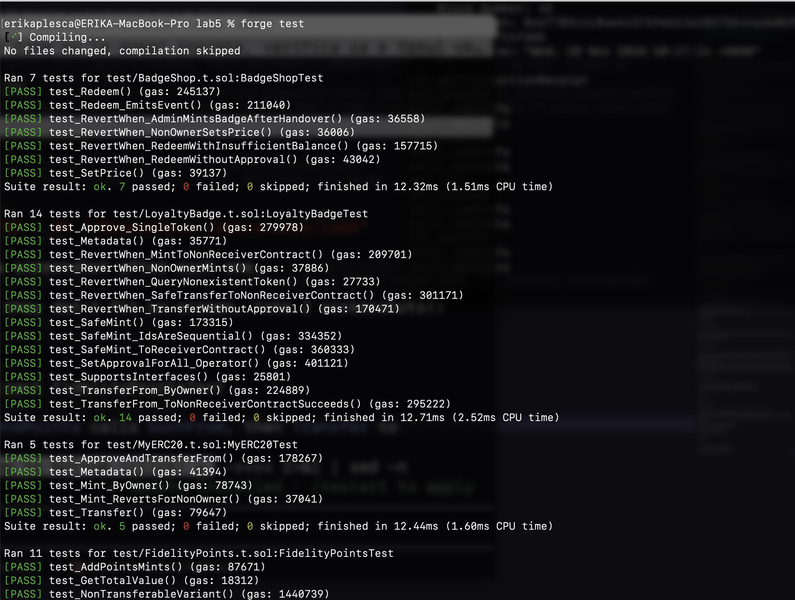
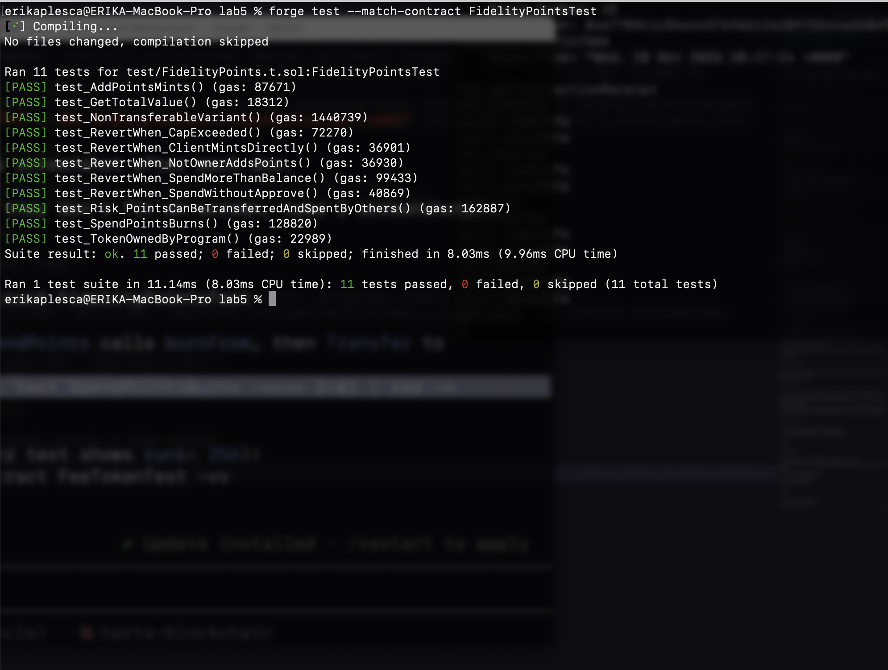
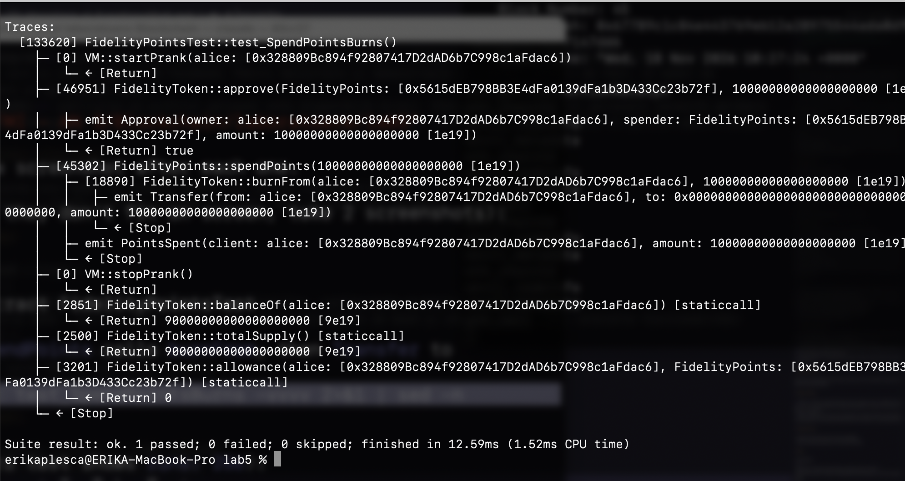
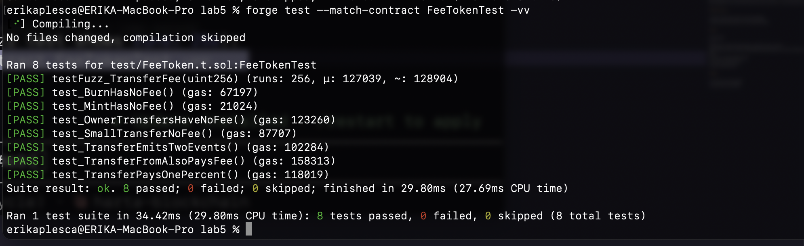

# Laborator 5: Token standards cu OpenZeppelin (ERC-20)

**Erika Plesca**, FMI, anul 3, Blockchain
Mediu: macOS, Foundry 1.9.0, solc 0.8.38, OpenZeppelin Contracts v5.7.0

## Setup

```bash
forge init lab5
cd lab5
rm src/Counter.sol test/Counter.t.sol script/Counter.s.sol
forge install OpenZeppelin/openzeppelin-contracts@v5.7.0
forge remappings > remappings.txt
```

Remapping-ul important e `@openzeppelin/contracts/=lib/openzeppelin-contracts/contracts/`. Așa `import "@openzeppelin/contracts/token/ERC20/ERC20.sol"` ajunge la fișierul din `lib/`.

```
lab05-erc20-tokens/
├── enunt.md                 (enunțul)
├── src/
│   ├── FidelityToken.sol    (din laborator: ERC20 + Burnable + Capped + Ownable)
│   ├── LoyaltyBadge.sol     (din laborator: ERC721 + URIStorage + Ownable)
│   ├── BadgeShop.sol        (din laborator: burnFrom FPT -> safeMint badge)
│   ├── MyERC20.sol          (din starter/)
│   ├── FidelityPoints.sol   (Ex 1)
│   └── FeeToken.sol         (Ex 2)
├── test/
│   ├── FidelityToken.t.sol  LoyaltyBadge.t.sol  BadgeShop.t.sol   (din laborator, 34 de teste)
│   ├── MyERC20.t.sol        (din starter/, 5 teste)
│   ├── FidelityPoints.t.sol (Ex 1, 11 teste)
│   └── FeeToken.t.sol       (Ex 2, 8 teste)
└── screenshots/
```

```bash
forge test        # 58 de teste, toate trec (34 din laborator + 5 MyERC20 + 19 ale mele)
```



---

## Exercițiul 1: Punctele de fidelitate ca token ERC-20

Am rescris `FidelityPoints` (versiunea din Lab 3, cu `spendPoints`, `totalPoints` și `onlyAdmin`) astfel încât punctele să fie tokeni `FidelityToken` (FPT).

```solidity
contract FidelityPoints is Ownable {
    FidelityToken public immutable token;
    uint256 public pointValue;

    event PointsSpent(address indexed client, uint256 amount);

    constructor(uint256 _pointValue, uint256 cap) Ownable(msg.sender) {
        pointValue = _pointValue;
        token = new FidelityToken(address(this), cap);   // FidelityPoints e owner-ul tokenului
    }

    function addPoints(address client, uint256 amount) external onlyOwner {
        token.mint(client, amount);
    }

    // clientul trebuie să dea întâi token.approve(address(fidelityPoints), amount)
    function spendPoints(uint256 amount) external {
        token.burnFrom(msg.sender, amount);
        emit PointsSpent(msg.sender, amount);
    }

    function setPointValue(uint256 _pointValue) external onlyOwner { pointValue = _pointValue; }

    function getTotalValue(address client) external view returns (uint256) {
        return token.balanceOf(client) * pointValue / 10 ** token.decimals();
    }
}
```

**Cum funcționează:**

- **Cine poate da mint:** `FidelityPoints` își creează tokenul în constructor și îi devine **owner**. Doar el poate apela `mint`. Dacă un client încearcă `fpt.mint(...)` direct pe token, primește `OwnableUnauthorizedAccount`.
- **`addPoints`:** face `mint`, adică un event `Transfer(address(0), client, amount)`.
- **`spendPoints`:** face `burnFrom(msg.sender, amount)`, adică un event `Transfer(client, address(0), amount)`. În token, `msg.sender` e contractul `FidelityPoints`, nu clientul. De aceea `burnFrom` consumă **allowance-ul** dat de client lui `FidelityPoints`, iar clientul trebuie să facă întâi `approve`. Altfel primește `ERC20InsufficientAllowance(fp, 0, amount)`, testat în `test_RevertWhen_SpendWithoutApprove`.
- **`getTotalValue`:** tokenul are 18 zecimale, deci 1 punct = 10¹⁸ unități. Împart la `10 ** decimals()` ca valoarea să fie per punct întreg: 100 de puncte × 10 = 1.000.

```bash
forge test --match-contract FidelityPointsTest
forge test --match-test test_SpendPointsBurns -vvvv 2>&1 | sed -n '/Traces/,/Suite/p'
```





**Ce funcții din contractul original nu mai sunt necesare?**

| Înainte (Lab 2/3) | Acum |
|---|---|
| `mapping points` + getter-ul `points(client)` | `token.balanceOf(client)` |
| `uint totalPoints`, `updateTotalPoints` (internal), `getTotalPoints()` | `token.totalSupply()` |
| verificarea că clientul are destule puncte în `spendPoints` (și `assert(totalPoints >= points[...])`) | OpenZeppelin dă `ERC20InsufficientBalance(client, balance, needed)` și garantează că suma balanțelor e egală cu `totalSupply` |
| `admin`, `modifier onlyAdmin`, `error NotAdmin` | `Ownable`: `onlyOwner`, `OwnableUnauthorizedAccount` |
| event-urile `PointsAdded` / `PointsSpent` | event-ul `Transfer` al tokenului (mint din `0`, burn către `0`). Am păstrat doar `PointsSpent`, ca să se vadă că punctele au fost folosite pe o recompensă, nu doar arse. |

Au rămas doar lucrurile specifice programului: `pointValue`, `setPointValue`, `getTotalValue` și „regula” de cine primește puncte (`addPoints`).

**Ce risc nou apare acum că punctele se pot transfera între clienți?**

> Punctele nu mai sunt legate de clientul care le-a câștigat. Oricine le poate trimite, vinde sau cumpăra:
>
> - **Apare o piață pentru puncte.** Cineva poate cumpăra puncte de la alții fără să fi cumpărat vreodată de la magazin. Programul de fidelitate nu mai răsplătește fidelitatea, ci pe cine are bani să cumpere puncte. Am testat asta în `test_Risk_PointsCanBeTransferredAndSpentByOthers`: Alice îi trimite lui Bob 100 de puncte, iar Bob le folosește în `spendPoints`.
> - **Punctele pot fi furate.** Dacă un client semnează un `approve` (mai ales unul infinit) către un contract rău-intenționat, sau dacă îi e furată cheia, punctele pot fi luate. Înainte, punctele stăteau într-un mapping pe care doar admin-ul îl putea modifica.
> - **Punctele pot fi pierdute** dacă sunt trimise la o adresă greșită, sau la un contract care nu le mai poate trimite mai departe.
> - Punctele au o valoare (`pointValue`), deci devin practic o monedă transferabilă.
>
> **Soluție** (dacă vrem să nu se poată transfera): în `NonTransferableFidelityToken` am suprascris `_update` ca să permită doar mint (`from == 0`) și burn (`to == 0`). Orice transfer între clienți dă `PointsNotTransferable()`, testat în `test_NonTransferableVariant`. Dezavantajul: tokenul nu mai e un ERC-20 „normal”, iar wallet-urile și exchange-urile îl vor vedea, dar transferul va eșua.

---

## Exercițiul 2: Taxa pe transfer

```solidity
contract FeeToken is FidelityToken {
    constructor(address initialOwner, uint256 cap_) FidelityToken(initialOwner, cap_) {}

    function _update(address from, address to, uint256 value) internal override {
        // mint (from = 0), burn (to = 0) și transferurile owner-ului nu plătesc taxă
        if (from == address(0) || to == address(0) || from == owner() || to == owner()) {
            super._update(from, to, value);
            return;
        }
        uint256 fee = value / 100;
        super._update(from, owner(), fee);
        super._update(from, to, value - fee);
    }
}
```

**De ce `_update`:** în OpenZeppelin v5, `transfer`, `transferFrom`, `_mint`, `_burn` și `burnFrom` ajung toate în `_update(from, to, value)`. E suficient să suprascriu o singură funcție ca regula să se aplice la orice mișcare de tokeni.

**Ce mai trebuie știut:**

- **Mint și burn:** le recunosc după `address(0)`. La mint `from == 0`, la burn `to == 0`. Nu plătesc taxă (`test_MintHasNoFee`, `test_BurnHasNoFee`).
- **Owner-ul:** enunțul zice „între doi clienți”, așa că am scutit și transferurile de la sau către owner. Altfel owner-ul și-ar plăti taxa sieși, iar când împarte puncte clientul ar primi doar 99% (`test_OwnerTransfersHaveNoFee`).
- **`transferFrom`** plătește și el taxa, pentru că trece tot prin `_update` (`test_TransferFromAlsoPaysFee`).
- **Un transfer emite 2 event-uri `Transfer`:** unul `alice → owner` pentru 1% și unul `alice → bob` pentru 99% (`test_TransferEmitsTwoEvents`).
- **`override` simplu:** `FeeToken` are o singură bază care definește `_update`, adică `FidelityToken`, unde e `virtual`. Deci ajunge `override`, fără listă. `super._update` merge mai departe prin `FidelityToken`, apoi `ERC20Capped` (care verifică cap-ul, dar doar la mint), apoi `ERC20`.
- **Rotunjirea:** `value / 100` se rotunjește în jos. Sub 100 de unități (wei de FPT), taxa e 0 (`test_SmallTransferNoFee`). Teoretic cineva ar putea evita taxa făcând multe transferuri mici, dar gas-ul ar costa mult mai mult decât taxa.

**Testul fuzz:**

```solidity
function testFuzz_TransferFee(uint256 amount) public {
    amount = bound(amount, 0, 100 ether);

    vm.prank(alice);
    assertTrue(fee.transfer(bob, amount));

    assertEq(fee.totalSupply(), 100 ether);                  // supply-ul nu se schimbă
    assertEq(fee.balanceOf(bob), amount - amount / 100);     // destinatarul primește exact atât
    assertEq(fee.balanceOf(owner), amount / 100);            // owner-ul primește taxa
    assertEq(fee.balanceOf(alice), 100 ether - amount);      // Alice plătește exact amount
}
```

Forge îl rulează cu 256 de valori aleatoare pentru `amount`. `bound` le limitează între 0 și cât are Alice (100 FPT), ca transferul să nu eșueze din lipsă de fonduri. Am verificat și că Alice plătește exact `amount`, iar owner-ul primește exact taxa: nu se pierde și nu se creează nimic.

```bash
forge test --match-contract FeeTokenTest -vv
```



---

**Ce înseamnă `decimals() = 18`?**
EVM-ul nu are numere cu virgulă, deci balanțele sunt numere întregi în cea mai mică unitate. `decimals` îi spune doar wallet-ului unde să pună virgula. 1,5 FPT e stocat ca `1500000000000000000`. În Solidity, `1.5 ether` face aceeași scalare.

**De ce trebuie `approve` înainte de `spendPoints`?**
Un contract nu poate lua tokeni din contul cuiva din proprie inițiativă. Clientul îi dă un allowance cu `approve(spender, amount)`, iar contractul folosește apoi `transferFrom` / `burnFrom`, care scad allowance-ul. Sunt 2 tranzacții. ERC-2612 (`permit`) permite să se facă într-una singură, cu o semnătură.

**Ce e un infinite approval?**
`approve(spender, type(uint256).max)`. În OpenZeppelin nu mai scade la `transferFrom`, deci economisește un `approve` la fiecare plată. Riscul: dacă contractul aprobat e rău-intenționat sau are un bug, poate lua **toți** tokenii. Se revocă cu `approve(spender, 0)`.

**De ce `override(ERC20, ERC20Capped)` în `FidelityToken`?**
Ambele baze definesc `_update`, iar Solidity obligă clasa derivată să spună explicit că le suprascrie pe amândouă. `super._update` le execută în ordinea liniarizării C3: întâi `ERC20Capped`, apoi `ERC20`.

**De ce cap-ul e `immutable`?**
E scris în bytecode la deploy și nu ocupă un slot de storage, deci citirea lui e ieftină: un `PUSH`, nu un `SLOAD`. Oricum nu se schimbă niciodată.

**Unde sunt de fapt tokenii?**
Nu în wallet. Sunt în storage-ul contractului token: `_balances`, un mapping în slotul 0. Wallet-ul doar citește `balanceOf` și semnează tranzacțiile.

**Ce problemă pot avea alte contracte cu `FeeToken`?**
E un token *fee-on-transfer*: cine primește `amount` prin `transferFrom` primește de fapt doar 99%. Un contract care presupune că a primit exact `amount` (un DEX, un magazin care își trimite tokenii lui însuși) va avea contabilitatea greșită. Trebuie să compare balanța înainte și după transfer.

**De ce `test_RevertWhen_SafeTransferToNonReceiverContract` face revert, dar `test_TransferFrom_ToNonReceiverContractSucceeds` merge?** (întrebarea din Step 3)
`NotAReceiver` e un contract gol, fără `onERC721Received`, iar `GoodReceiver` implementează `IERC721Receiver` și întoarce selectorul `0x150b7a02`.
- `safeTransferFrom` verifică: dacă destinatarul are cod, îi cheamă `onERC721Received` și cere să primească înapoi selectorul. `NotAReceiver` nu are funcția, deci se face revert cu `ERC721InvalidReceiver(nr)`.
- `transferFrom` nu verifică nimic, deci transferul reușește, iar `ownerOf(id)` devine `NotAReceiver`.
- În al doilea caz, badge-ul e **blocat pentru totdeauna**. `NotAReceiver` nu are nicio funcție care să cheme `transferFrom` sau `approve`, deci nimeni nu-l mai poate muta.

**Ce e un fuzz test?**
Un test cu parametri, pe care Forge îl rulează cu multe valori aleatoare (256 implicit). Verifică o **proprietate** valabilă pentru orice valoare, nu doar un exemplu. Dacă găsește o valoare pentru care pică, o afișează ca contra-exemplu.
