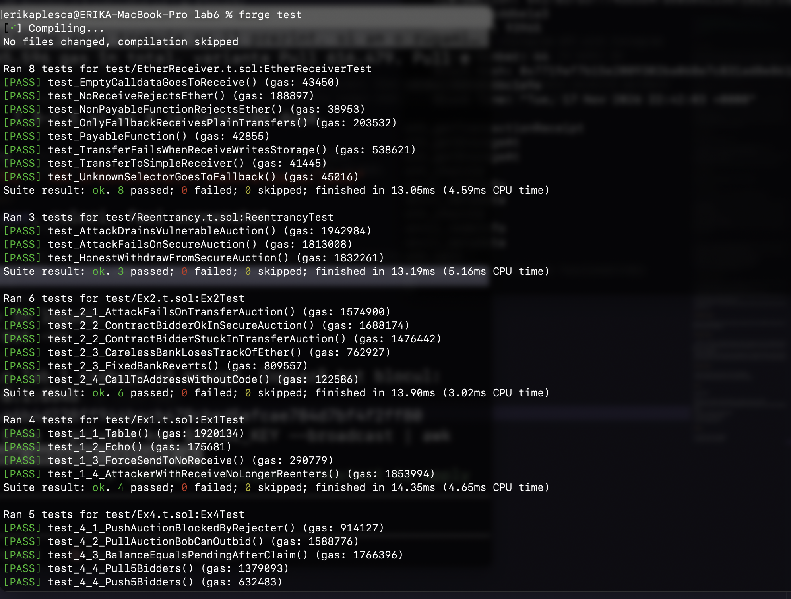
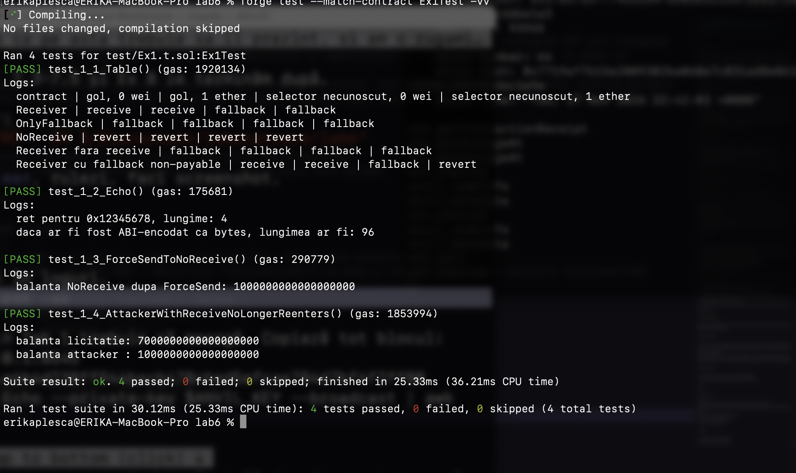
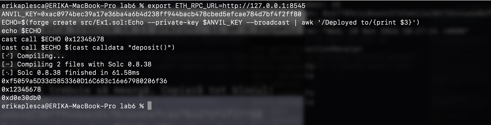
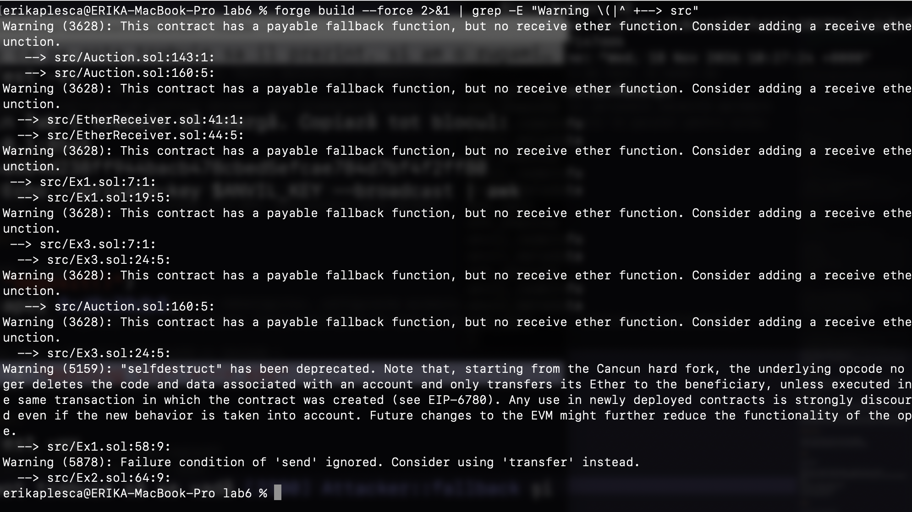
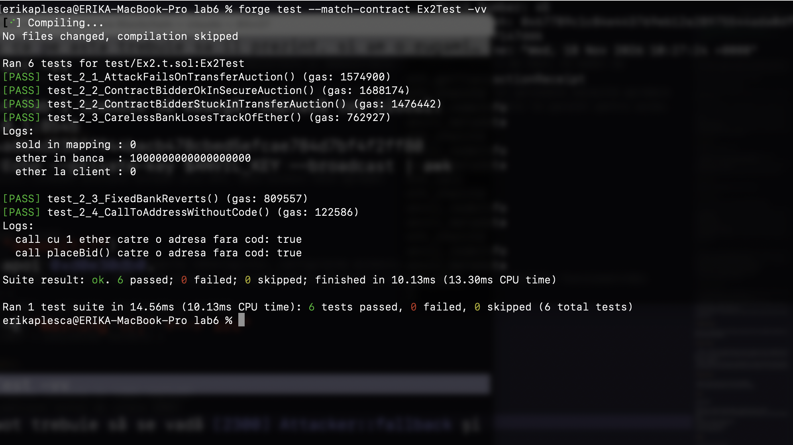
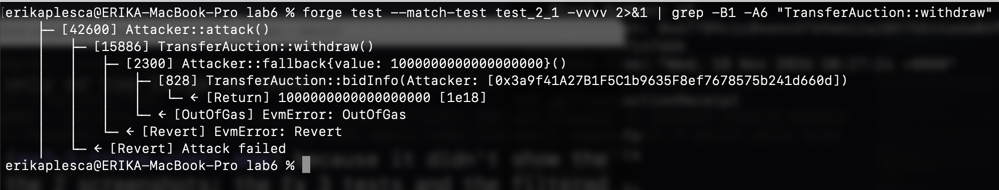
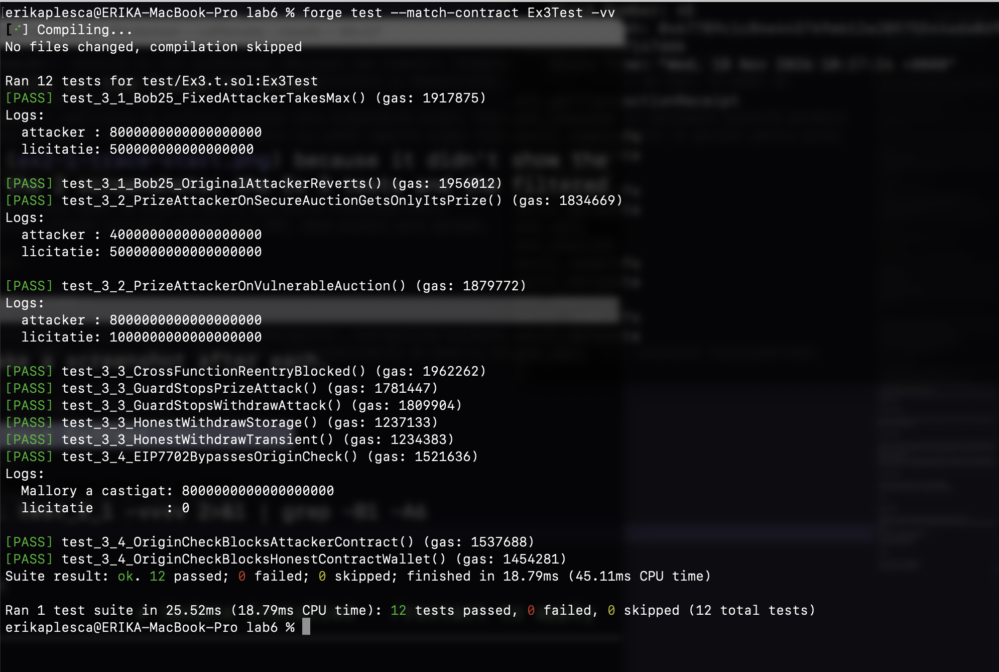
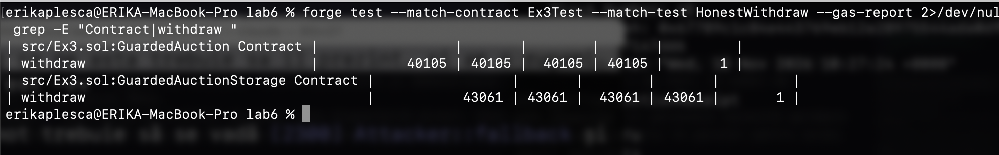
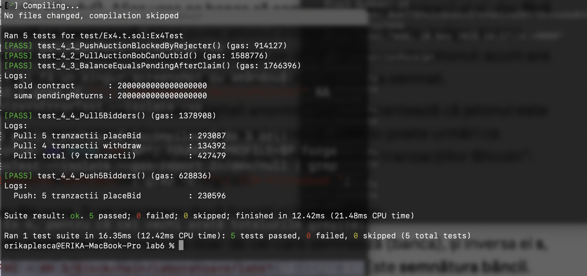
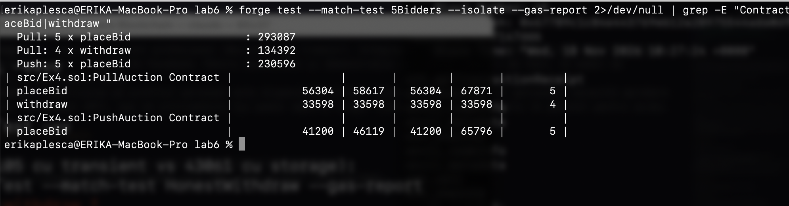

# Laborator 6: receive, fallback, trimiterea de ether, re-entrancy, withdrawal pattern

## Structura

```
lab06-ether-reentrancy/
├── src/
│   ├── EtherReceiver.sol   (din laborator; la CountingReceiver am adăugat bid / withdrawFrom pentru 2.2)
│   ├── Auction.sol         (din laborator, nemodificat)
│   ├── Ex1.sol  Ex2.sol  Ex3.sol  Ex4.sol
├── test/
│   ├── EtherReceiver.t.sol  Reentrancy.t.sol   (din laborator)
│   ├── Ex1.t.sol  Ex2.t.sol  Ex3.t.sol  Ex4.t.sol
└── screenshots/
```

Am pus codul fiecărui exercițiu într-un fișier separat, `ExN.sol`, cu testele în `ExN.t.sol`. Testele au în nume numărul punctului, de exemplu `test_3_1_...`.

```bash
forge test        # 38 teste, toate trec
```



---

## Exercițiul 1: `receive` și `fallback`

### 1.1 Tabelul

Am făcut două copii ale lui `Receiver` în `src/Ex1.sol`:

- `ReceiverNoReceive`: fără `receive`;
- `ReceiverNonPayableFallback`: are `receive`, dar `fallback` nu e `payable`.

În test (`test_1_1_Table`) trimit cele 4 tipuri de apel la fiecare contract și mă uit la event-ul emis (`ViaReceive` / `ViaFallback`). La `OnlyFallback`, care nu emite nimic, mă uit la contorul `fallbackCalls`. Testul afișează tabelul și verifică fiecare celulă cu `assertEq`.

```bash
forge test --match-contract Ex1Test -vv
```

| Contract | calldata gol, 0 wei | calldata gol, 1 ether | selector necunoscut, 0 wei | selector necunoscut, 1 ether |
|---|---|---|---|---|
| `Receiver` | receive | receive | fallback | fallback |
| `OnlyFallback` | fallback | fallback | fallback | fallback |
| `NoReceive` | revert | revert | revert | revert |
| `Receiver` fără `receive` | fallback | fallback | fallback | fallback |
| `Receiver` cu `fallback` non-payable | receive | receive | fallback | **revert** |




- **Calldata gol:** merge în `receive` dacă există; altfel în `fallback`; dacă nu e nici `fallback`, face revert.
- **Selector necunoscut:** merge mereu în `fallback`, dacă există.
- **`NoReceive`:** nu are nici `receive`, nici `fallback`, deci orice apel de genul ăsta dă revert.
- **`fallback` non-payable + ether:** compilatorul pune la început o verificare `msg.value > 0 → revert`. De asta e singura celulă cu revert pe rândul ăla. Fără ether, același `fallback` merge.

!! într-un `fallback` non-payable nici nu pot citi `msg.value`. Dă `Error 5887`, așa că în copie emit direct 0.

### 1.2 `Echo`

```solidity
contract Echo {
    fallback(bytes calldata input) external returns (bytes memory) {
        return input;
    }
}
```

Pe anvil:

```bash
ECHO=$(forge create src/Ex1.sol:Echo --private-key $ANVIL_KEY --broadcast | awk '/Deployed to/{print $3}')
cast call $ECHO 0x12345678                     # 0x12345678
cast call $ECHO $(cast calldata "deposit()")   # 0xd0e30db0
```



**Ce se întoarce:** exact calldata-ul trimis. `Echo` nu are funcția `deposit()`, deci apelul ajunge în `fallback`, care întoarce `input` neschimbat. `0xd0e30db0` e chiar selectorul lui `deposit()`.

**De ce nu e ABI-encodat:** la forma `fallback(bytes calldata) returns (bytes memory)`, compilatorul trimite bytes-ii înapoi **direct** (`return(ptr, len)`), fără să-i împacheteze.

- O funcție normală care întoarce `bytes` ar da 96 de bytes: offset (`0x20`), lungime (`4`) și datele completate cu zero până la 32. Am verificat în test: `abi.encode(hex"12345678").length == 96`, iar `Echo` întoarce doar 4 bytes.
- Așa poate un proxy să întoarcă răspunsul implementării exact cum l-a primit, oricare ar fi funcția.

### 1.3 `ForceSend` și `selfdestruct`

```solidity
contract ForceSend {
    constructor(address target) payable {
        selfdestruct(payable(target));
    }
}
```

În `test_1_3_ForceSendToNoReceive`:

- întâi un transfer normal de 1 ether către `NoReceive` dă `ok = false`;
- apoi `new ForceSend{value: 1 ether}(address(n))`: acum `NoReceive` are **1 ether**, deși n-are nicio funcție care să accepte ether și nu i s-a executat nicio linie de cod.

**De ce nu ne putem baza pe `address(this).balance == totalDeposits`:** balanța poate crește fără ca un contract să poată refuza:

- prin `selfdestruct`;
- prin recompense sau taxe de bloc trimise la adresa lui;
- prin ether trimis la adresă înainte ca acel contract să fie deployat (adresa se poate calcula dinainte).

Deci balanța poate deveni mai mare decât suma depunerilor. Dacă un contract ar avea `require(address(this).balance == totalDeposits)`, oricine l-ar putea bloca cu 1 wei. Contabilitatea trebuie ținută în variabilele proprii, nu dedusă din balanță.

**Warning-ul pentru `selfdestruct`:** `Warning (5159): "selfdestruct" has been deprecated`. Spune că de la Cancun (EIP-6780) opcode-ul nu mai șterge codul contractului, doar trimite ether-ul. Excepție: când e apelat în aceeași tranzacție în care contractul a fost creat, cum e cazul la noi, în constructor.

### 1.4 Warning 3628 și `Attacker` cu `receive`

```bash
forge build --force 2>&1 | grep -E "Warning \(|^ +--> src"
```



`Warning (3628): This contract has a payable fallback function, but no receive ether function` apare la `OnlyFallback` și la `Attacker`. Apare și la copiile mele `ReceiverNoReceive` și `AttackerMax`, din același motiv.

Ambele au `fallback` payable și n-au `receive`, deci transferurile simple (calldata gol) ajung în `fallback`. Compilatorul recomandă să fie separate: `receive` pentru ether, `fallback` pentru apeluri cu date necunoscute.

Am făcut `AttackerWithReceive` (în `Ex1.sol`), identic cu `Attacker`, plus `receive() external payable {}`.

**Mai merge atacul? Nu.** `test_1_4_AttackerWithReceiveNoLongerReenters`:

- attacker-ul are la final doar **1 ether**, adică oferta lui;
- licitația rămâne cu **7 ether** (Alice + Bob);
- `attack()` nu dă revert: e doar un `withdraw` normal.

**De ce:** refund-ul vine cu calldata gol, deci acum ajunge în `receive`, care nu face nimic. Codul de re-entrancy e în `fallback`, care nu se mai execută. Atacul depindea de faptul că transferul ajungea în `fallback`.

---

## Exercițiul 2: Trimiterea de ether

```bash
forge test --match-contract Ex2Test -vv
```



### 2.1 `TransferAuction`

E o copie a lui `VulnerableAuction` cu `payable(msg.sender).transfer(refundAmount)`. Ordinea greșită a rămas: transferul se face înainte de `bids[msg.sender] = 0`.

**Reușește atacul? Nu.** Testul `test_2_1_AttackFailsOnTransferAuction` așteaptă `"Attack failed"`, iar licitația rămâne cu 8 ether.

```bash
forge test --match-test test_2_1 -vvvv 2>&1 | grep -B1 -A6 "TransferAuction::withdraw"
```

```
├─ [15886] TransferAuction::withdraw()
│   ├─ [2300] Attacker::fallback{value: 1000000000000000000}()
│   │   ├─ [828] TransferAuction::bidInfo(Attacker: [...])
│   │   └─ ← [OutOfGas] EvmError: OutOfGas
│   └─ ← [Revert] EvmError: Revert
└─ ← [Revert] Attack failed
```



Unde pică atacul:

1. `fallback` primește doar 2.300 gas (stipend-ul lui `transfer`).
2. Apelul `bidInfo` consumă 828 din ei.
3. Nu mai ajunge gas pentru al doilea apel `withdraw()`, care ar trebui să citească storage, să trimită ether etc. Rezultatul e `OutOfGas` în `fallback`.
4. `transfer` face revert când primitorul eșuează, deci `withdraw` face revert, iar `attack` dă `"Attack failed"`.

### 2.2 De ce `transfer` nu e totuși o soluție bună

Am adăugat la `CountingReceiver` funcțiile `bid(auction)` și `withdrawFrom(auction)`.

În `test_2_2_ContractBidderStuckInTransferAuction`, `CountingReceiver` licitează 1 ether, pierde, și **nu își mai poate lua banii niciodată**: am încercat de două ori și ambele încercări dau revert. Motivul: `receive` face `totalReceived += msg.value`, adică un `SSTORE`, iar `SSTORE` nu merge cu mai puțin de 2.301 gas rămas (EIP-2200).

În `test_2_2_ContractBidderOkInSecureAuction`, același contract își ia banii din `SecureAuction` fără probleme, pentru că `call` trimite tot gas-ul.

**De ce e mai rău decât cu `SecureAuction`:**

- Cu `transfer`, banii unui utilizator cinstit rămân blocați **pentru totdeauna**: nu există altă cale de a-i scoate.
- Lovește exact utilizatorii care folosesc contracte ca portofel (multisig, smart wallets), nu atacatorul.
- Se bazează pe un cost fix de gas care se poate schimba la un upgrade, ca la EIP-1884.

`SecureAuction` rezolvă re-entrancy-ul corect, prin ordinea CEI, și lasă orice primitor să primească banii.

### 2.3 `CarelessBank`

```solidity
function withdraw(uint256 amount) external {
    balances[msg.sender] -= amount;
    payable(msg.sender).send(amount);     // rezultatul e ignorat
}
```

Compilatorul avertizează: `Warning (5878): Failure condition of 'send' ignored`.

Clientul de test (`RevertingClient`) are un `receive` care face revert. După `withdraw(1 ether)`:

| | valoare |
|---|---|
| `balances[client]` | **0** |
| ether în bancă | **1 ether** |
| ether la client | 0 |

Tranzacția a reușit, soldul a fost scăzut, dar ether-ul **a rămas în bancă** și nu mai aparține nimănui în contabilitate. Clientul și-a pierdut banii, iar banca are mai mult ether decât suma soldurilor.

**Fix** (`FixedBank`):

```solidity
balances[msg.sender] -= amount;
(bool ok,) = msg.sender.call{value: amount}("");
require(ok, "Transfer failed");
```

Acum, dacă trimiterea eșuează, toată tranzacția face revert, inclusiv scăderea soldului. Testul `test_2_3_FixedBankReverts` confirmă: soldul rămâne 1 ether.

### 2.4 `call` către o adresă fără cod

`test_2_4_CallToAddressWithoutCode`:

- `nobody.call{value: 1 ether}("")` întoarce **`true`**, iar `nobody` chiar primește 1 ether;
- `nobody.call(abi.encodeWithSignature("placeBid()"))` întoarce tot **`true`**, deși acolo nu e nicio funcție;
- un apel normal `VulnerableAuction(nobody).placeBid()` face **revert**, pentru că apelurile high-level verifică întâi că adresa are cod (`extcodesize`).

**Ce implică:** dacă un contract face un `call` low-level la o adresă greșită (o greșeală de scriere, un contract nedeployat încă, deployat pe altă rețea), apelul „reușește”. Contractul crede că funcția s-a executat, dar de fapt nu s-a întâmplat nimic, iar ether-ul trimis e pierdut. Trebuie verificat `target.code.length > 0` înainte, sau folosite apeluri high-level prin interfață.

---

## Exercițiul 3: Re-entrancy

```bash
forge test --match-contract Ex3Test -vv
```



### 3.1 Bob licitează 2,5 ether

Licitația are acum 5 + 2,5 + 1 = **8,5 ether**.

**Atacul original nu mai merge.** Testul `test_3_1_Bob25_OriginalAttackerReverts` arată că `attack()` dă `"Attack failed"` și licitația rămâne cu 8,5 ether. Attacker-ul nu ia nimic, nici măcar oferta lui.

Ce se întâmplă, urmărind trace-ul (`forge test --match-test test_3_1_Bob25_Original -vvvv`):

1. Se fac 8 refund-uri de câte 1 ether, iar în licitație rămân 0,5 ether.
2. În `fallback`, condiția e `balance >= bidInfo / 5`, adică `0,5 >= 0,2`: adevărat, deci reintră încă o dată.
3. Al 9-lea `withdraw` încearcă să trimită 1 ether, dar contractul are doar 0,5. `call` întoarce `false`, deci `"Withdrawal failed"`.
4. `require(success)` din `fallback` face revert, deci și `withdraw`-ul de deasupra primește `false` și face `"Withdrawal failed"`. Și tot așa, în cascadă, până la `attack`.
5. Toată tranzacția se anulează.

**Condiția corectată** (`AttackerMax` în `Ex3.sol`):

```solidity
if (address(auction).balance >= bidInfo) {   // înainte: bidInfo / 5
```

Reintră doar dacă mai e cel puțin un refund întreg în contract. Rezultat în `test_3_1_Bob25_FixedAttackerTakesMax`: attacker-ul ia **8 ether**, iar în licitație rămân 0,5. Mai mult nu poate lua, pentru că `withdraw` trimite mereu toată oferta (1 ether) și nu poate trimite mai puțin.

### 3.2 `PrizeAttacker`, re-entrancy pe `claimPrize`

`PrizeAttacker` licitează cel mai mult. În `receive`, cât timp `highestBid` e încă nenul și licitația mai are cel puțin `highestBid`, cheamă din nou `claimPrize()`. În `VulnerableAuction`, `highestBid = 0` se face abia după `call`.

Scenariu: Alice 2, Bob 3, PrizeAttacker 4, deci 9 ether în licitație.

| | `VulnerableAuction` | `SecureAuction` |
|---|---|---|
| attacker primește | **8 ether**: premiul de 2 ori | **4 ether**: doar premiul lui |
| rămâne în licitație | 1 ether | 5 ether |
| Bob își poate lua cei 3 ether? | nu, `"Withdrawal failed"` | da |

**`SecureAuction.claimPrize` nu e vulnerabil**, pentru că pune `highestBid = 0` **înainte** de `call`. În `receive`, attacker-ul vede `highestBid = 0` și nu mai are ce cere. Dacă ar reintra totuși, ar primi `"Already claimed"`.

### 3.3 `nonReentrant` cu `bool transient locked`

`GuardedAuction` e `VulnerableAuction` cu ordinea greșită **păstrată**, plus un modifier:

```solidity
bool transient locked;
error ReentrantCall();

modifier nonReentrant() {
    if (locked) revert ReentrantCall();
    locked = true;
    _;
    locked = false;
}
```

Modifier-ul e pus pe `withdraw` și pe `claimPrize`.

- **Atacul pe `withdraw`** (`Attacker`): `"Attack failed"`, licitația rămâne cu 8 ether.
- **Atacul pe `claimPrize`** (`PrizeAttacker`): `"Attack failed"`, licitația rămâne cu 9 ether.

**Poate `Attacker` intra în `claimPrize` din `withdraw`? Nu.** E aceeași variabilă `locked` pentru ambele funcții. Cât timp `withdraw` rulează, `locked = true`, deci orice altă funcție cu `nonReentrant` dă `ReentrantCall()`.

Am verificat cu `CrossAttacker`: în `receive` cheamă `claimPrize` și salvează eroarea primită. Testul verifică `lastError == ReentrantCall.selector`. Asta oprește și re-entrancy-ul *cross-function*.

**Gas** (`GuardedAuctionStorage` e la fel, dar cu `bool locked` normal):

```bash
forge test --match-contract Ex3Test --match-test HonestWithdraw --gas-report
```

| lock | gas `withdraw` |
|---|---|
| `bool transient locked` | **40.105** |
| `bool locked` (storage) | **43.061** (+2.956) |



**Explicație:**

- **Transient:** `TLOAD` și `TSTORE` costă câte 100 gas, deci în total ≈ 300 (un `TLOAD`, două `TSTORE`). Se șterge singur la finalul tranzacției.
- **Storage:** `locked` a ajuns în **același slot** cu `auctionEnded`, slotul 3 (am verificat cu `forge inspect GuardedAuctionStorage storageLayout`).
  - Citirea cold a slotului (2.100) o plătesc oricum ambele variante, ca să citească `auctionEnded`.
  - Diferența vine din scrieri: `locked = true` e un `SSTORE` nenul → nenul de 2.900 (slotul e deja nenul, pentru că `auctionEnded = true`), apoi `locked = false` e încă 100.
  - Asta dă ≈ 3.000 în loc de 300, plus ceva cod de mascare pentru `bool`-ul împachetat.
  - Ar mai fi un refund de 2.800 la final, pentru că slotul revine la valoarea inițială, dar gas report-ul nu îl scade.
- Dacă `locked` ar fi fost **singur** într-un slot, ar fi fost mult mai rău: 0 → 1 costă 20.000. De asta `ReentrancyGuard` din OpenZeppelin (varianta cu storage) folosește valorile 1 și 2 în loc de 0 și 1.

### 3.4 De ce nu ajunge `require(tx.origin == msg.sender)`

Am făcut `OriginCheckAuction`, care are verificarea asta în `withdraw`.

**1. Blochează `Attacker`-ul clasic.** Când contractul cheamă `withdraw`, `msg.sender` e contractul, iar `tx.origin` e Mallory, deci verificarea pică (`test_3_4_OriginCheckBlocksAttackerContract`).

**2. Nu ajunge, din mai multe motive:**

- **EIP-7702 (Pectra, 2025):** un cont EOA poate avea cod. În `test_3_4_EIP7702BypassesOriginCheck`, Mallory își atașează codul `DelegatedAttacker` cu `vm.signAndAttachDelegation` și licitează direct din EOA. Când primește refund-ul, codul ei reintră în `withdraw`, iar `msg.sender == tx.origin == Mallory` la fiecare reintrare. A golit licitația: **+8 ether**.
- Nu rezolvă cauza, adică ordinea greșită a liniilor. Rămâne vulnerabil la re-entrancy prin alte contracte, de exemplu dacă contractul ar trimite tokeni cu callback.

**3. Pe cine exclude:** pe toți utilizatorii cinstiți care nu sunt EOA:

- portofelele multisig (Safe);
- smart contract wallets (ERC-4337);
- DAO-urile;
- alte contracte sau protocoale care vor să folosească licitația.

În `test_3_4_OriginCheckBlocksHonestContractWallet`, un „wallet” contract licitează, pierde și nu își mai poate lua banii înapoi niciodată.

---

## Exercițiul 4: Withdrawal pattern

```bash
forge test --match-contract Ex4Test -vv
```



### 4.1 `PushAuction` + `MaliciousRejecter`

`PushAuction.placeBid` acceptă doar oferte mai mari decât `highestBid` și îl plătește imediat pe cel depășit, cu `call` + `require(success)`. `MaliciousRejecter` are un `receive` care face mereu revert.

Scenariu: Alice 1 ether, apoi Rejecter 2 ether (Alice primește 1 ether înapoi), apoi Bob 3 ether.

- **Oferta lui Bob face revert** cu `"Refund failed"`, pentru că refund-ul către Rejecter eșuează. Bob nu pierde banii, se anulează toată tranzacția, dar nu poate licita.
- Nimeni nu mai poate da o ofertă mai mare, deci **Rejecter câștigă cu 2 ether**. E un denial of service: un singur participant blochează licitația pentru toți.

### 4.2 `PullAuction`

`placeBid` nu mai trimite nimic. Doar notează `pendingReturns[previousBidder] += highestBid`. Fiecare își ia banii cu `withdraw()`, scris după CEI: citesc, pun pe 0, apoi trimit.

Același scenariu (`test_4_2_PullAuctionBobCanOutbid`):

- **Bob poate licita 3 ether** și devine `highestBidder`;
- `pendingReturns`: Alice 1 ether, Rejecter 2 ether;
- Alice își retrage banii fără probleme;
- **doar Rejecter nu își poate lua banii** (`"withdraw failed"`), pentru că propriul lui `receive` îi refuză. Se blochează doar pe el.

### 4.3 `endAuction` și `claim`

- `endAuction()` (doar seller-ul) setează `ended = true` și atât, nu plătește pe nimeni.
- `claim()` (doar seller-ul, după final, o singură dată, cu flag-ul `claimed`) trimite `highestBid` către seller.

În `test_4_3_BalanceEqualsPendingAfterClaim`:

- **Înainte de `claim`:** soldul contractului = suma `pendingReturns` + `highestBid`.
- **După `claim`:** soldul contractului = **2 ether** = suma `pendingReturns` nerestituite, adică doar banii Rejecter-ului.

Testul mai verifică trei lucruri:

- al doilea `claim` dă `"Already claimed"`;
- câștigătorul (Bob) nu are nimic de retras;
- după final nu se mai poate licita.

**De ce `claim` și `withdraw` nu trebuie să plătească niciodată același ether de două ori:** fiecare ether din contract aparține exact cuiva:

- oferta câștigătoare aparține seller-ului;
- ofertele depășite aparțin celor din `pendingReturns`.

Dacă aceeași sumă ar putea fi plătită pe două căi, contractul ar plăti mai mult decât are. Ultimii care vin să retragă n-ar mai găsi banii, adică cineva ar fi plătit de fapt cu banii altuia.

La mine asta e evitat prin trei lucruri:

1. oferta câștigătoare nu ajunge niciodată în `pendingReturns`;
2. `claimed` face ca `claim` să meargă o singură dată;
3. `placeBid` e blocat după `ended`. Fără asta, cineva ar putea licita după `claim`, iar oferta deja plătită a vechiului câștigător ar ajunge în `pendingReturns` și ar fi plătită a doua oară.

### 4.4 Gas: Push vs Pull, 5 ofertanți

5 ofertanți licitează 1, 2, 3, 4 și 5 ether, fiecare mai mult decât precedentul.

```bash
forge test --match-test 5Bidders --isolate --gas-report
```



| | Push | Pull |
|---|---|---|
| 5 × `placeBid` | 230.596 | 293.087 |
| `withdraw` | – | 4 × 33.598 = 134.392 |
| **total** | **230.596** (5 tranzacții) | **427.479** (9 tranzacții) |

Enunțul zice să adun 21.000 pe tranzacție, dar Foundry 1.9 îi include deja în gas-ul raportat pentru fiecare apel din test. Am verificat pe anvil: `gasUsed` din receipt e exact aceeași valoare. Deci n-am mai adunat nimic.

Sunt 4 `withdraw`, nu 5, pentru că al cincilea ofertant câștigă și nu are ce retrage. Seller-ul ar mai face un `claim`.

**Cine plătește refund-urile:**

- **Push:** **noul ofertant** plătește refund-ul celui de dinainte. `placeBid` include un `call` cu valoare (9.000 gas + 2.600 pentru adresa cold).
- **Pull:** **fiecare** își plătește singur `withdraw`-ul. `placeBid` e mai scump, pentru că scrie `pendingReturns` din 0 în nenul (22.100). În plus, fiecare care pierde mai face o tranzacție.

| | Push | Pull |
|---|---|---|
| Denial of service | un primitor care refuză banii blochează licitația pentru toți | cel care refuză se blochează doar pe el |
| Re-entrancy | un apel extern în fiecare `placeBid` | un singur loc cu apel extern (`withdraw`), scris după CEI |
| Gas | mai ieftin în total (≈ 231k) | mai scump în total (≈ 427k), dar împărțit pe fiecare |
| Utilizare | banii se întorc automat | utilizatorul trebuie să-și amintească să facă `withdraw` |

Concluzie: Pull e mai scump și puțin mai incomod, dar e varianta sigură. De asta e recomandată în documentația Solidity.

---

## Întrebări pe care mi le-ar putea pune

**Care e diferența dintre `receive` și `fallback`?**
`receive` e doar pentru calldata gol (transfer simplu) și trebuie să fie `payable`. `fallback` prinde tot ce nu se potrivește cu nicio funcție, iar dacă nu există `receive`, prinde și transferurile simple. Poate fi și non-payable.

**De ce se recomandă `call` și nu `transfer`?**
`transfer` dă doar 2.300 gas: blochează contractele-portofel (2.2) și depinde de costuri care se schimbă la upgrade-uri. `call` merge cu orice primitor, dar trebuie verificat rezultatul (2.3) și trebuie protejat contractul de re-entrancy, prin CEI sau un lock.

**Ce e checks–effects–interactions?**
Întâi verifici condițiile, apoi modifici starea, abia la final chemi alt contract. Între `SecureAuction` și `VulnerableAuction` diferă doar ordinea a două linii: `bids[msg.sender] = 0` înainte sau după `call`.

**De ce la `SecureAuction` attacker-ul nu păstrează nici primul refund, cel legitim?**
Reintrarea pică (`"No funds to withdraw"`), iar `require(success)` din `fallback` propagă eroarea până sus, deci se anulează **toată** tranzacția. Și-ar putea lua oferta cu un contract care nu reintră.

**Ce e transient storage?**
Un tip de storage (EIP-1153, opcode-urile `TLOAD`/`TSTORE`) care se șterge automat la finalul tranzacției și costă 100 gas pe operație. E perfect pentru lock-uri, care trebuie să existe doar în timpul unei tranzacții.

**De ce n-a mai șters `selfdestruct` contractul `ForceSend`?**
Din cauza EIP-6780: acum șterge contractul doar dacă e apelat în aceeași tranzacție în care contractul a fost creat. La noi era în constructor, deci da, `ForceSend` chiar dispare. În restul cazurilor doar trimite ether-ul.

**Ce a fost The DAO?**
Atacul din 2016, cu exact acest tip de re-entrancy, prin care s-au furat ≈ 3,6 milioane ETH. A dus la hard fork-ul care a separat Ethereum de Ethereum Classic.
