# Laborator 7: Shop dApp (citirea stării, tranzacții și events din pagina web)

**Erika Plesca**, FMI, anul 3, Blockchain
Mediu: macOS, Foundry 1.9.0, Node.js 26, React 19 + Vite 7, ethers.js v6, MetaMask, anvil (chain ID 31337)

## Structura

```
lab07-shop-dapp/
├── enunt.md                     (enunțul)
├── starter/                     (demo-dapp-ul primit, punctul de plecare)
├── contracts/                   (Foundry: FidelityPoints cu events, scriptul de deploy, teste)
└── src/
    ├── utils/EthersUtils.js     (toate apelurile către contract: aici e cea mai mare parte din exerciții)
    ├── components/Points.jsx    (pagina: sold, valoare, istoric, subscripții)
    ├── components/AdminPanel.jsx   (+ formularul pentru setPointValue)
    ├── components/SpendPanel.jsx   (Ex 3, nou)
    ├── components/History.jsx      (Ex 2, nou)
    └── styles/Points.css
```

## Setup

```bash
cd contracts && forge build && forge test        # 4 teste
anvil                                            # în alt tab
forge script script/DeployFidelityPoints.s.sol --rpc-url http://127.0.0.1:8545 --broadcast --private-key 0xac09...ff80
cd .. && npm install && npm run dev              # http://localhost:5173
```

Scriptul de deploy scrie adresa și ABI-ul în `src/contracts/`, iar de acolo le citește pagina. În MetaMask am adăugat rețeaua Anvil (`http://127.0.0.1:8545`, chain ID 31337) și am importat contul 0 (admin) și contul 1 (client).

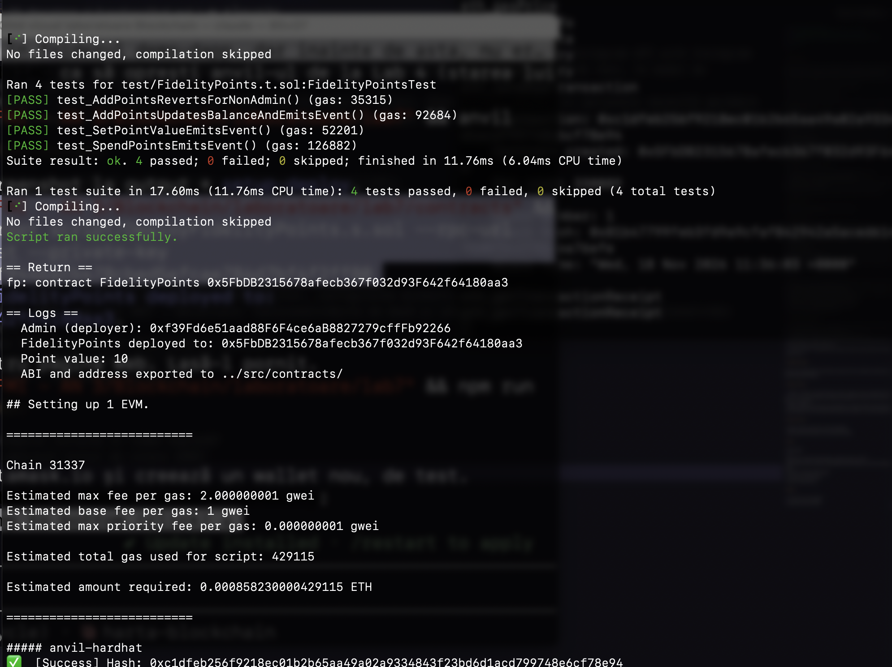
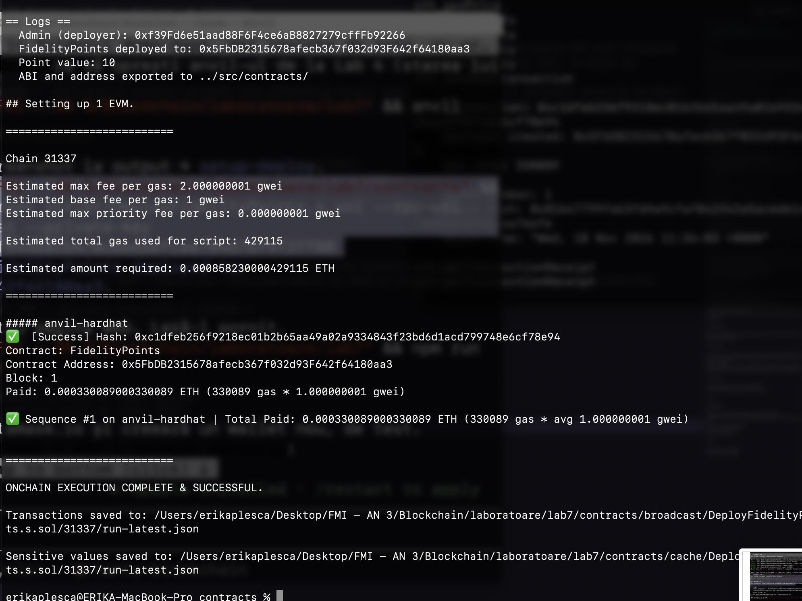

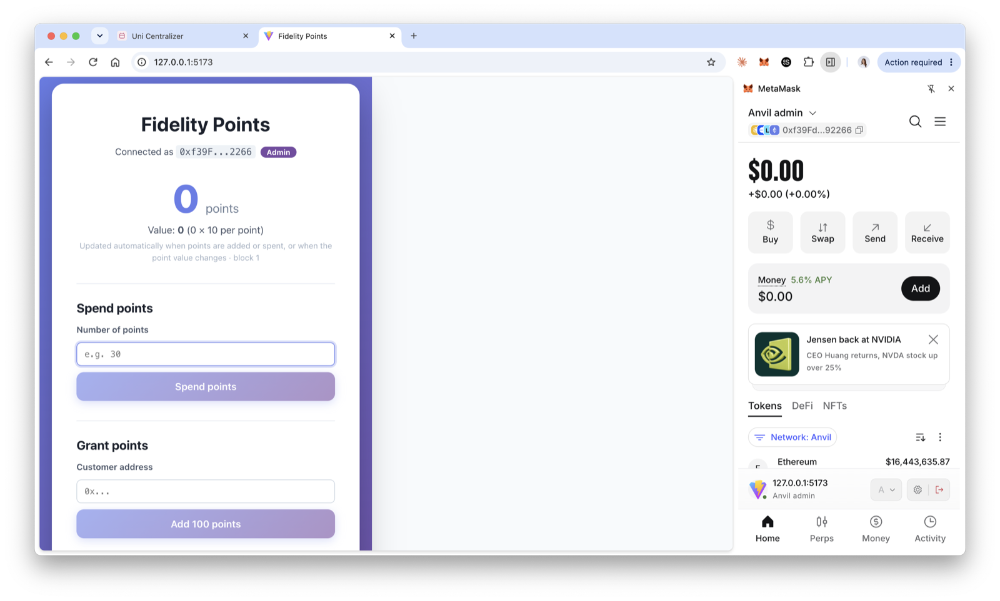

Ca admin văd badge-ul **Admin** și formularul **Grant points**. Soldul e 0, pentru că nimeni nu mi-a dat puncte: constructorul nu dă puncte admin-ului.

**Ce am observat la setup:**

- **Aceeași adresă după restart:** după restartul lui anvil, contractul a primit tot `0x5FbD…0aa3`. Adresa se calculează din `keccak256(rlp(deployer, nonce))`, iar contul 0 are din nou nonce 0, deci `addresses.json` rămâne valid.
- **Al doilea Connect:** la primul Connect, MetaMask a schimbat rețeaua pe Anvil, iar pagina s-a resetat la butonul Connect (evenimentul `chainChanged`). La al doilea Connect a mers.
- **Problemă pe Mac:** proiectul e pe Desktop, care se sincronizează cu iCloud. Cu discul aproape plin, iCloud scosese de pe disc o parte din `node_modules`, iar Vite rămânea blocat și pagina era albă. Am rezolvat cu `rm -rf node_modules && npm install`.
- **Prima tranzacție a dat eroare:** `could not coalesce error`. E un mesaj generic al lui ethers, care ascunde eroarea MetaMask din interior. Am făcut `getErrorMessage` să afișeze eroarea interioară, iar motivul real era *„The requested account and/or method has not been authorized by the user”* (4100). Site-ul primise permisiune doar pe rețeaua pe care eram la primul Connect, nu și pe Anvil. Am rezolvat prin deconectarea site-ului din MetaMask și o conectare nouă, cu Anvil bifat la *Networks*.

---

## Pasul 6: Subscripția la events

Două ferestre deschise în paralel: `127.0.0.1:5173` cu **admin-ul** și `localhost:5173` cu **clientul**. MetaMask ține minte câte un cont pentru fiecare site, iar pentru el cele două adrese sunt site-uri diferite.

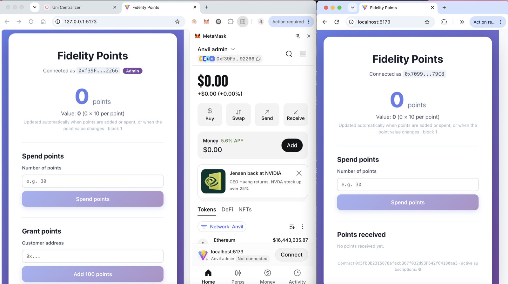

**6.2: admin-ul dă 100 de puncte din pagină.** MetaMask cere confirmarea tranzacției: rețeaua e Anvil, cererea vine de la `127.0.0.1:5173`, iar contractul apelat e `0x5FbDB…80aa3`.

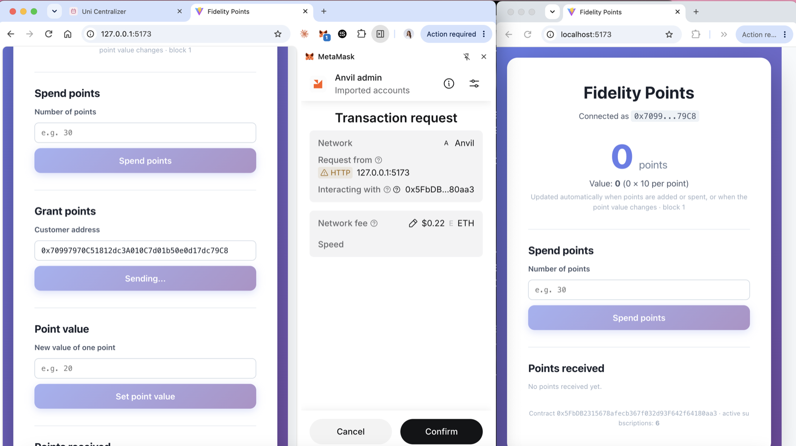

Fereastra clientului a trecut de la 0 la **100 de puncte** (valoare 1000) fără reload, iar în *Points received* a apărut `+100 points · block 2`. Schimbarea nu e instantă, ci vine **câteva secunde** după ce tranzacția e minată. Provider-ul face polling la 4 secunde, deci așteaptă următoarea întrebare către nod. În terminalul lui anvil se vede: `eth_blockNumber`, apoi câte un `eth_getLogs` pentru fiecare filtru.

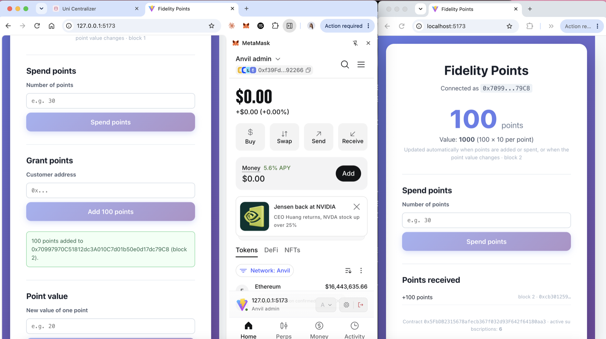

**6.4: încă 50 de puncte, din terminal.**

```bash
cast send $FP "addPoints(address,uint256)" 0x7099…79C8 50 --private-key 0xac09…ff80 --rpc-url http://127.0.0.1:8545
# status 1 (success), block 3, gas used 35929
```

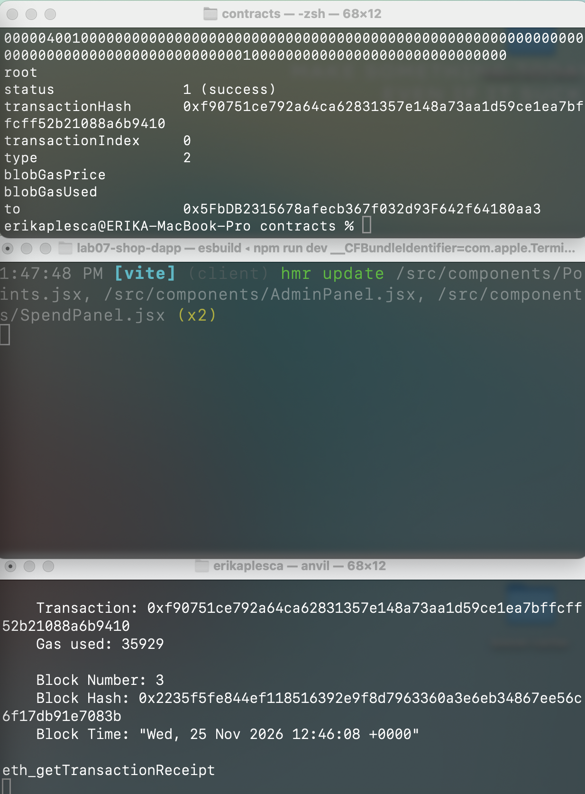

Fereastra clientului s-a actualizat la fel: **150 de puncte** (valoare 1500), iar în istoric apare `+50 points · block 3` deasupra lui `+100 · block 2`. Tranzacția n-a trecut nici prin pagină, nici prin MetaMask, dar log-ul `PointsAdded` e același, oricine ar fi trimis tranzacția. Pagina reacționează la **eveniment**, nu la buton.

Gas-ul e mult mai mic decât la deploy (35.929 față de 330.089). Aici se modifică doar două sloturi de storage (`points[client]` și totalul) și se emite un log. Deploy-ul scrie tot codul contractului.


**6.5: puncte pentru o a treia adresă** (contul 2 din anvil, `0x3C44…93BC`, 30 de puncte). Tranzacția intră în blocul 4, dar fereastra clientului **nu se schimbă**: rămâne la 150 de puncte, cu ultimul bloc afișat 3 și istoricul cu 2 rânduri. În anvil se vede polling-ul (`eth_blockNumber`, `eth_getLogs` × n), dar niciun `eth_call` pentru soldul clientului. **Nodul filtrează:** `eth_getLogs` cere doar logs cu topic-ul `0x7099…`, iar log-ul pentru `0x3C44…` nu se potrivește. Pagina nu primește nimic, deci nu recitește nimic.

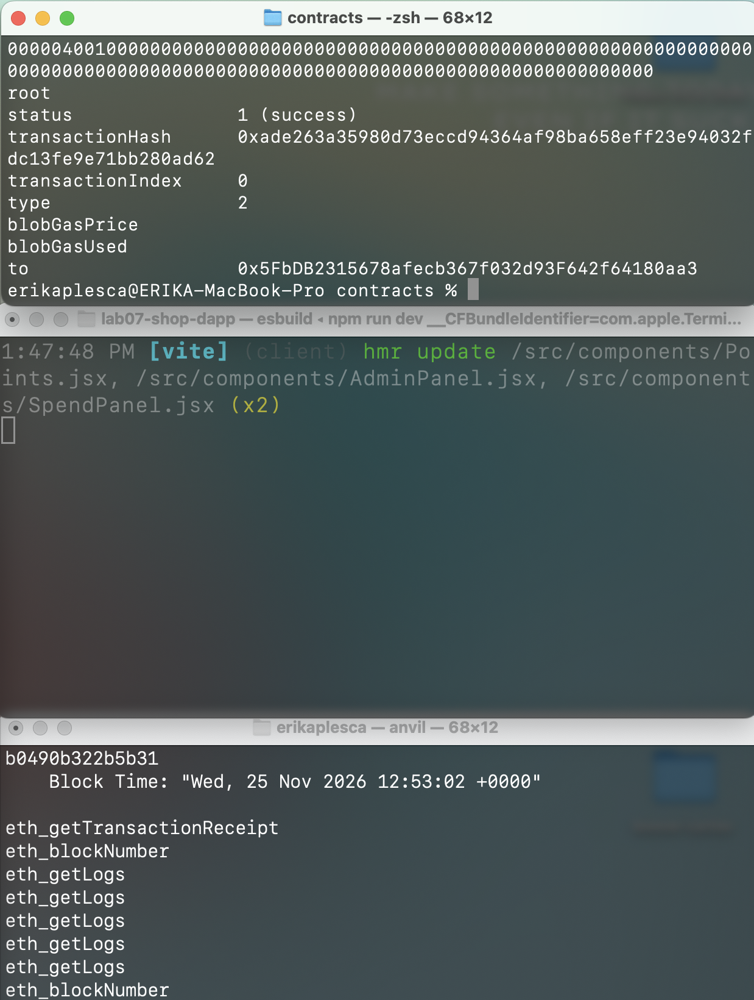
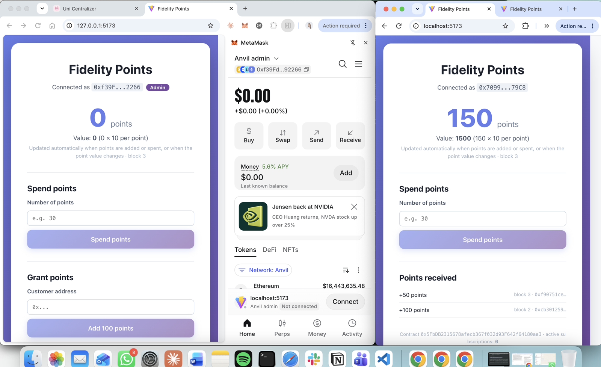

**6.6: clientul încearcă `addPoints` cu propria cheie.**

```
Error: Failed to estimate gas: ... execution reverted: custom error 0x17a84242: ...70997970c5...
  : NotAdmin(0x70997970C51812dc3A010C7d01b50e0d17dc79C8)
```

- **Revert la estimare:** `cast` face întâi `eth_estimateGas`, simularea pică cu revert, iar tranzacția **nici nu se trimite**. Nonce-ul clientului rămâne `0x0` și nu se plătește gas.
- **Eroarea:** `0x17a84242` e selectorul erorii `NotAdmin(address)`, iar argumentul e adresa clientului. `cast` o decodează pentru că are ABI-ul în proiect.
- **Formularul ascuns nu protejează nimic:** clientul nu vede formularul în pagină, dar poate apela contractul direct. Protecția e modifier-ul `onlyAdmin` din contract.

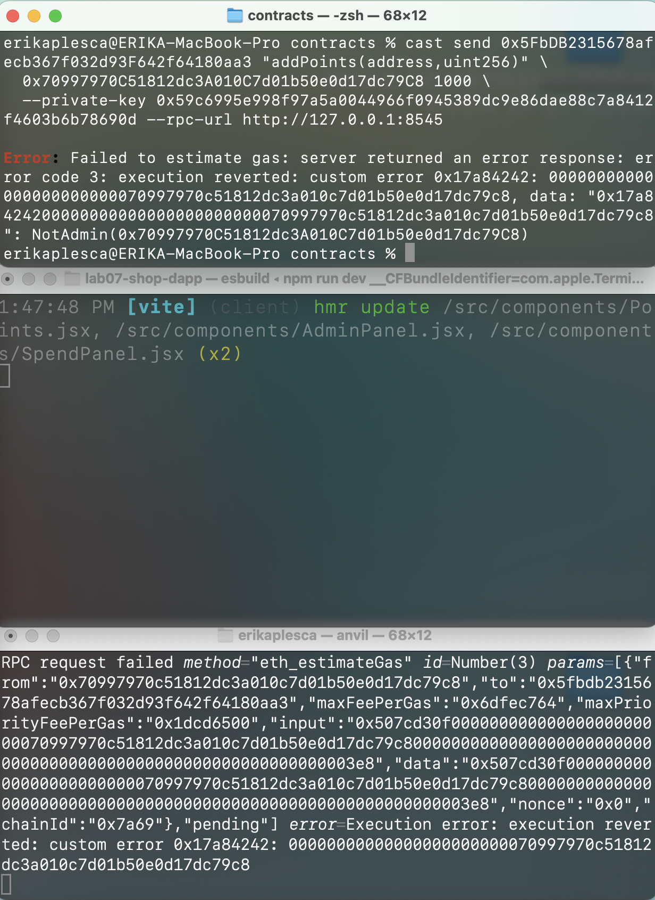

---

## Exercițiul 1: Valoarea punctelor + `PointValueChanged`

Sub numărul de puncte afișez `getTotalValue(account)`, adică `points × pointValue`, în unitatea prețurilor din catalog.

```js
// EthersUtils.js
const getTotalValue = async (address, blockTag = 'latest') =>
    Number(await getContract().getTotalValue(address, {blockTag}));

const subscribeToPointValueChanges = (onChange) => {
    const contract = getContract();
    const filter = contract.filters.PointValueChanged();
    const handle = (...args) => onChange(args[args.length - 1].log.blockNumber);
    contract.on(filter, handle);
    return () => contract.off(filter, handle);
};
```

**Când se actualizează valoarea:**

- **la `PointsAdded` și `PointsSpent` ale contului:** se schimbă numărul de puncte;
- **la `PointValueChanged`:** se schimbă valoarea unui punct.

În ambele cazuri pagina **recitește** din contract, la blocul evenimentului: punctele, `getTotalValue` și `pointValue`. Nu calculez nimic din datele event-ului, așa că starea contractului rămâne singura sursă de adevăr.

**Filtrul nu are cont:** `PointValueChanged(uint oldValue, uint newValue)` nu are niciun parametru `indexed`. Filtrul are doar primul topic (hash-ul semnăturii), deci **toți** clienții primesc evenimentul. E corect, pentru că schimbarea valorii punctului îi afectează pe toți.

Ca admin-ul să poată schimba valoarea din pagină, am adăugat în `AdminPanel` un formular **Set point value**. Merge și cu `cast send ... "setPointValue(uint256)" 20`.

| Moment | Puncte | Valoare punct | Valoare afișată |
|---|---|---|---|
| după `addPoints` 100 + 50 (Pasul 6) | 150 | 10 | **1.500** |
| admin-ul face `setPointValue(20)` (blocul 5) | 150 | 20 | **3.000**, în fereastra clientului, fără reload |

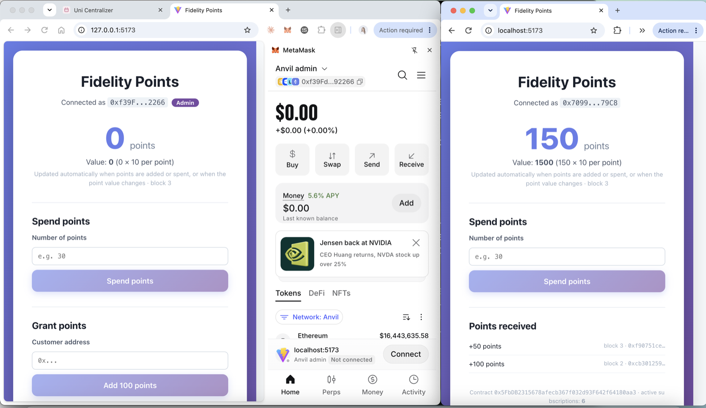

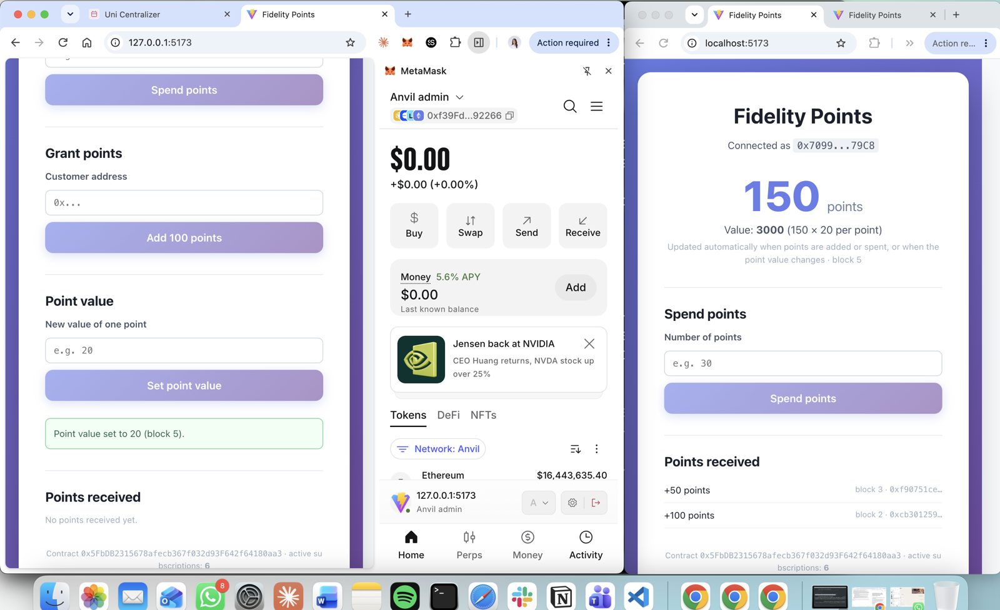

Evenimentul a ajuns la **ambele** ferestre. Filtrul `PointValueChanged()` nu conține nicio adresă, deci toți cei abonați primesc log-ul. Soldul clientului (150) nu s-a schimbat, doar valoarea unui punct. Pagina a recitit `getTotalValue` la blocul 5.

---

## Exercițiul 2: Istoricul punctelor primite

```js
// la încărcarea paginii: evenimentele din trecut
const getPointsHistory = async (client) => {
    const contract = getContract();
    const events = await contract.queryFilter(contract.filters.PointsAdded(client), FROM_BLOCK);
    return events.map(toHistoryEntry);      // {id, blockNumber, amount, txHash}
};
```

- **`FROM_BLOCK`** vine din `addresses.json` (`fromBlock`), adică blocul în care a fost deployat contractul. Nu are rost să caut mai devreme.
- **`queryFilter` e echivalentul lui `cast logs`:** un singur `eth_getLogs` cu topic-ul contului. Filtrarea o face nodul.
- **Evenimentele noi** vin din subscripția deja existentă. Am modificat `subscribeToPointsChanges` ca, la `PointsAdded`, să trimită pe lângă numărul blocului și detaliile log-ului, pe care pagina le adaugă în listă.
- **Fără duplicate:** același log ar putea veni și din `queryFilter`, și din subscripție, dacă evenimentul apare chiar în timp ce pagina se încarcă. De aceea fiecare intrare are un id unic, `txHash + "-" + logIndex`, iar pagina ignoră id-urile pe care le are deja.

Rezultat: după reload, istoricul e tot acolo, pentru că vine din logs, nu din memoria paginii. Punctele date altui cont nu apar în lista mea. De exemplu, cele 30 de puncte pentru `0x3C44…` din Pasul 6.5 nu apar.

Logs nu sunt în storage-ul contractului. Contractul ține doar soldul curent (`points[client]`), nu și istoricul. Logs sunt salvate de nod în receipt-urile tranzacțiilor: sunt mai ieftine decât storage-ul, dar un contract nu le poate citi. Doar cei din afară le pot citi, cu `eth_getLogs`.


---

## Exercițiul 3: `spendPoints`

`SpendPanel.jsx` are un câmp și butonul **Spend points**, care apelează `spendPoints(amount)` cu signer-ul contului conectat. Contractul scade din `points[msg.sender]`, deci fiecare își poate cheltui doar propriile puncte.

**Soldul se actualizează prin event, nu prin cod:** după `tx.wait()` nu modific soldul în pagină. Îl actualizează subscripția, când vine evenimentul `PointsSpent(client, amount)`. Am verificat: 150 → spend 30 → **120**, după câteva secunde.

**Ce se întâmplă dacă clientul cheltuie mai mult decât are?**

> `spendPoints` face `points[msg.sender] -= _points`. În Solidity 0.8 scăderea e verificată, deci 120 − 700 dă revert cu **`Panic(0x11)`** (underflow).
>
> - **Tranzacția nici nu se trimite.** Înainte să o semneze, MetaMask (prin ethers) face `eth_estimateGas`, iar estimarea pică. Clientul **nu plătește gas** și starea nu se schimbă.
> - În pagină, eroarea vine cu error data `0x4e487b71…11`. Am adăugat în `getErrorMessage` decodarea pentru `Panic`, așa că pagina afișează *"You don't have enough points (the subtraction underflowed: Panic 0x11)."*
> - Contractul din proiect nu are o eroare custom pentru asta, de aceea apare un `Panic`. Cu un `if (available < amount) revert InsufficientPoints(...)` (ca la Lab 4, Ex 7.2), mesajul ar putea spune și câte puncte are clientul.

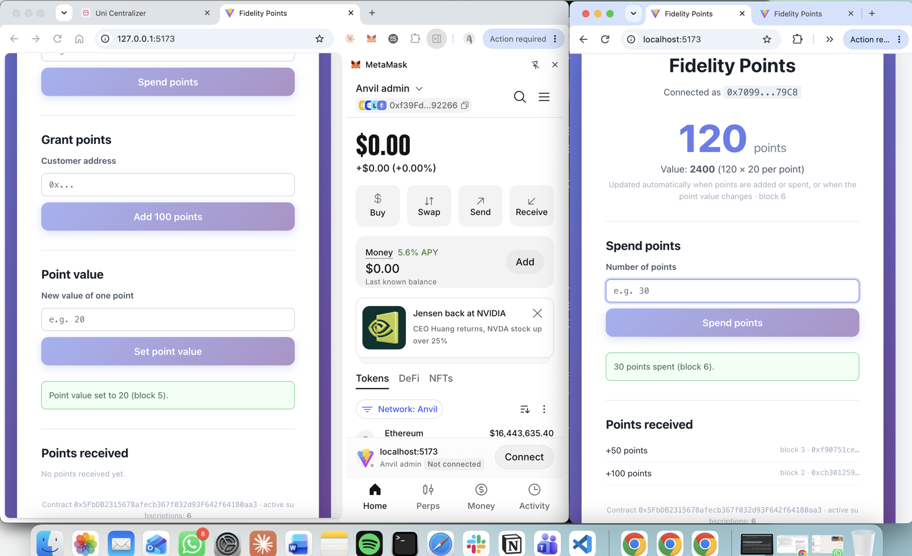

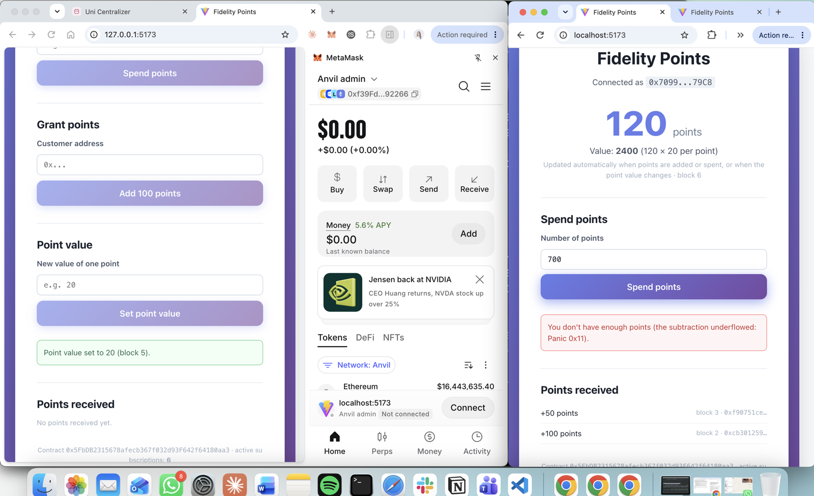

---

## Exercițiul 4: Fără `contract.off`

Ca să nu șterg codul, am pus un „comutator” în `EthersUtils.js`:

```js
const UNSUBSCRIBE_ON_CLEANUP = true;     // Ex 4: pune false
...
return () => {
    if (!UNSUBSCRIBE_ON_CLEANUP) return;   // nu mai apelăm contract.off
    contract.off(addedFilter, handleAdded);
    contract.off(spentFilter, handleSpent);
};
```

Ca să se vadă efectul, în josul paginii afișez **numărul de subscripții active** ale provider-ului (`provider.listenerCount()`, actualizat la 2 secunde).

**Ce se întâmplă:** în `Points.jsx`, `<Dashboard key={wallet.address} …/>` creează un Dashboard **nou** la fiecare schimbare de cont. Cel vechi e scos de pe ecran, iar React îi rulează funcția de cleanup din `useEffect`. Fără `off`, cleanup-ul nu mai oprește nimic, iar subscripțiile Dashboard-ului vechi rămân active.

**Ce am observat în browser** (în fereastra `localhost`, cu `UNSUBSCRIBE_ON_CLEANUP = false`):

| moment | `active subscriptions` |
|---|---|
| la început (cu `off` sau fără, înainte de orice schimbare) | 6 |
| după prima schimbare de cont (client → admin) | **9** |
| după mai multe schimbări, înapoi pe client | **17** |

La fiecare schimbare, cele 3 subscripții ale Dashboard-ului vechi rămân active: `PointsAdded(cont)`, `PointsSpent(cont)` și `PointValueChanged()`. Am verificat înainte și cu un test al funcțiilor din `EthersUtils.js`, pe un anvil separat, și am obținut tot 6 → 17 după 4 schimbări.

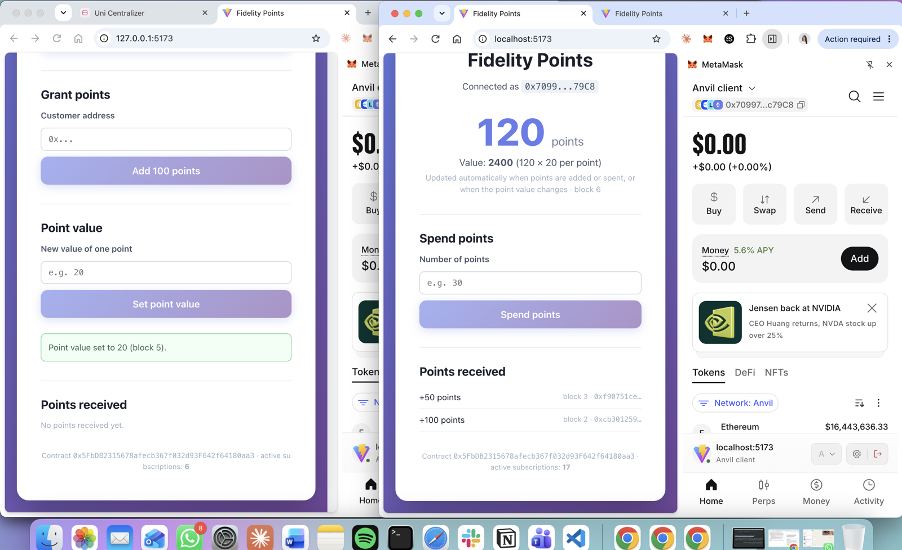

**Cât timp nu apare un bloc nou, nu se vede aproape nimic.** Provider-ul întreabă la 4 secunde doar `eth_blockNumber`. Anvil face blocuri doar când primește tranzacții, deci subscripțiile în plus nu generează cereri. Vedeam doar `eth_blockNumber` repetat, plus cererile Dashboard-ului nou la fiecare schimbare (`eth_call` ×3, `eth_getLogs`, `eth_getCode`).

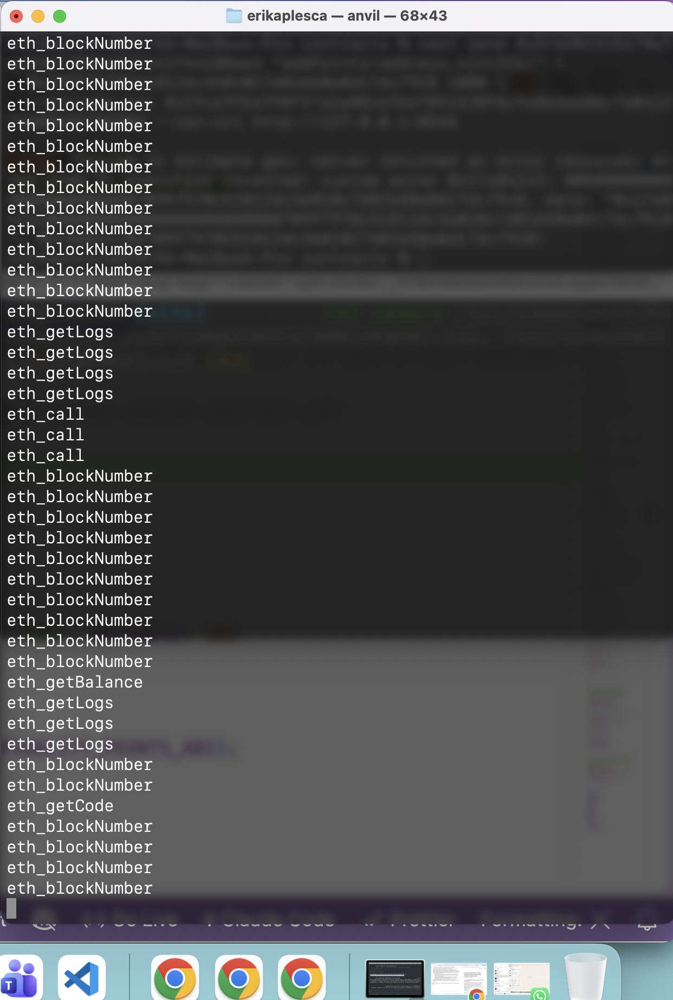

**Cu un bloc nou se vede scurgerea.** Admin-ul a făcut `setPointValue(25)` (blocul 7). În anvil a apărut un șir lung de `eth_getLogs`, câte unul pentru fiecare filtru, inclusiv cele vechi, apoi multe `eth_call`. Fiecare handler vechi recitește soldul, valoarea și `pointValue`, chiar dacă nu mai e pe ecran.

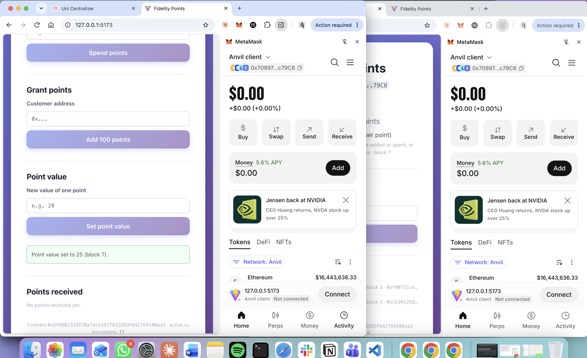
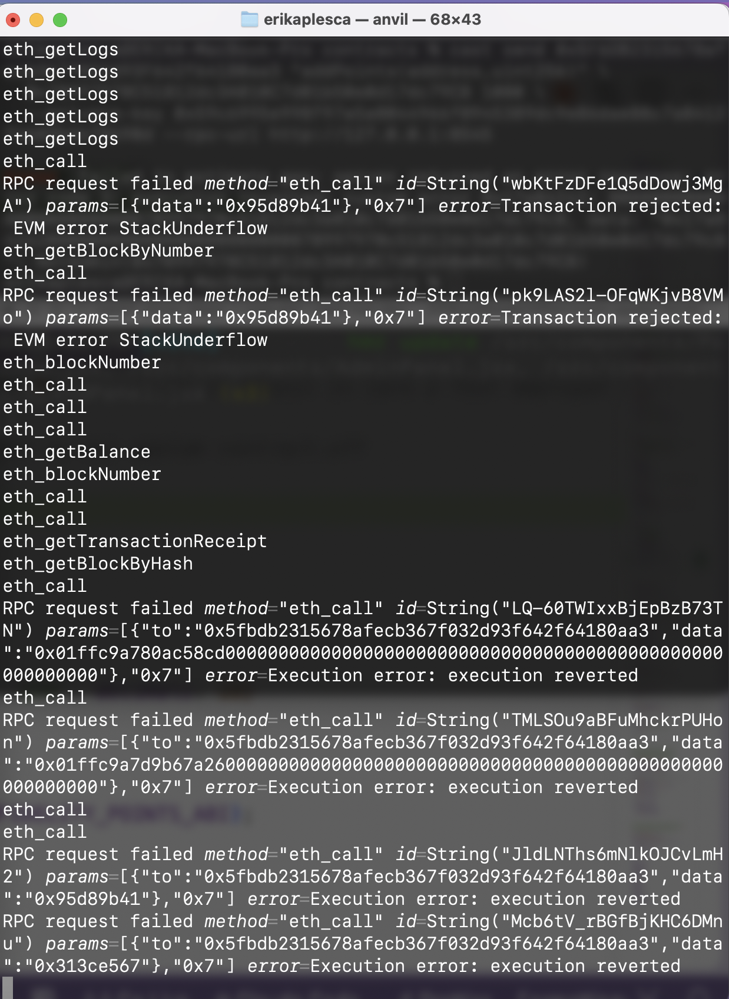

**Nu toate cererile sunt ale paginii.** Liniile `RPC request failed` cu `0x01ffc9a7…` (`supportsInterface`, verificare ERC-721/1155), `0x95d89b41` (`symbol()`) și `0x313ce567` (`decimals()`) vin de la **MetaMask**. După o tranzacție, MetaMask verifică dacă contractul e un token sau un NFT, ca să o afișeze frumos în *Activity*. `FidelityPoints` nu are funcțiile astea, deci apelurile dau revert.

**Explicație:**

- **Provider-ul face polling:** la fiecare 4 secunde întreabă `eth_blockNumber`, iar la fiecare bloc nou cere `eth_getLogs` pentru **fiecare filtru**. Filtrele vechi (`PointsAdded(contulVechi)` etc.) rămân în listă, deci cererile se înmulțesc cu fiecare cont prin care am trecut. ethers grupează listenerii cu același filtru, de aceea cererile cresc mai încet decât numărul de subscripții.
- **Handler-ele vechi rulează și ele:** un singur event apelează handler-ul tuturor Dashboard-urilor vechi. Fiecare recitește soldul din contract (`eth_call`), chiar dacă rezultatul e aruncat, pentru că `active = false` pe un Dashboard care nu mai e pe ecran. Asta înseamnă cereri degeaba.
- **Asta e un memory/request leak:** cu cât schimbi contul de mai multe ori, cu atât pagina face mai multe cereri. Se oprește doar la reload.
- **React StrictMode agravează problema.** În modul dev, StrictMode montează fiecare componentă de 2 ori, ca să prindă exact astfel de greșeli. Fără `off`, chiar de la prima încărcare rămâne o subscripție în plus.

**Unde se văd cererile:** în tab-ul *Network* al paginii **nu** apar. Cu `BrowserProvider`, cererile JSON-RPC sunt trimise prin extensia MetaMask, nu direct de pagină. Le-am văzut în terminalul lui `anvil`, care afișează fiecare metodă RPC primită: `eth_getLogs`, `eth_blockNumber`…

---

## Întrebări pe care mi le-ar putea pune

**Care e diferența dintre o citire și o tranzacție din pagină?**
O citire (`contract.points(account)`) e un `eth_call`: e gratuită, imediată și nu are nevoie de signer. O tranzacție (`contract.connect(signer).addPoints(...)`) e semnată de MetaMask, costă gas, iar rezultatul îl știu abia după ce e minată (`await tx.wait()`).

**Ce e provider, signer, ABI?**
- **Provider:** obiectul care trimite cereri la nod. Aici e MetaMask (`window.ethereum`), învelit de ethers.
- **Signer:** contul care semnează tranzacțiile.
- **ABI:** descrierea JSON a funcțiilor și a event-urilor. Din ABI, ethers generează câte o metodă JavaScript pentru fiecare funcție a contractului.

**Cum „primește” pagina un event?**
Nodul nu trimite nimic singur. Provider-ul face **polling** la 4 secunde și întreabă de logs noi care se potrivesc cu filtrul. De aceea actualizarea apare cu câteva secunde întârziere, iar events dinainte de subscripție nu vin, ci se iau cu `queryFilter` (Ex 2).

**De ce recitesc soldul în loc să adun `amount`?**
Ca un event duplicat sau întârziat să nu dea un total greșit. Contractul e singura sursă de adevăr. Citesc la blocul evenimentului (`{blockTag: blockNumber}`), iar o citire mai veche nu suprascrie una mai nouă (`shownBlock`).

**Ascunderea formularului de admin protejează contractul?**
Nu. E doar pentru comoditate. Oricine poate apela `addPoints` cu `cast send`. Protecția e `onlyAdmin` din contract: am încercat cu cheia clientului și am primit `NotAdmin`.

**De ce filtrez după `client`?**
Pentru că e `indexed`, deci e al doilea topic al log-ului. Nodul îmi trimite doar evenimentele contului meu. Punctele date altei adrese nu generează nicio cerere în pagina mea.
